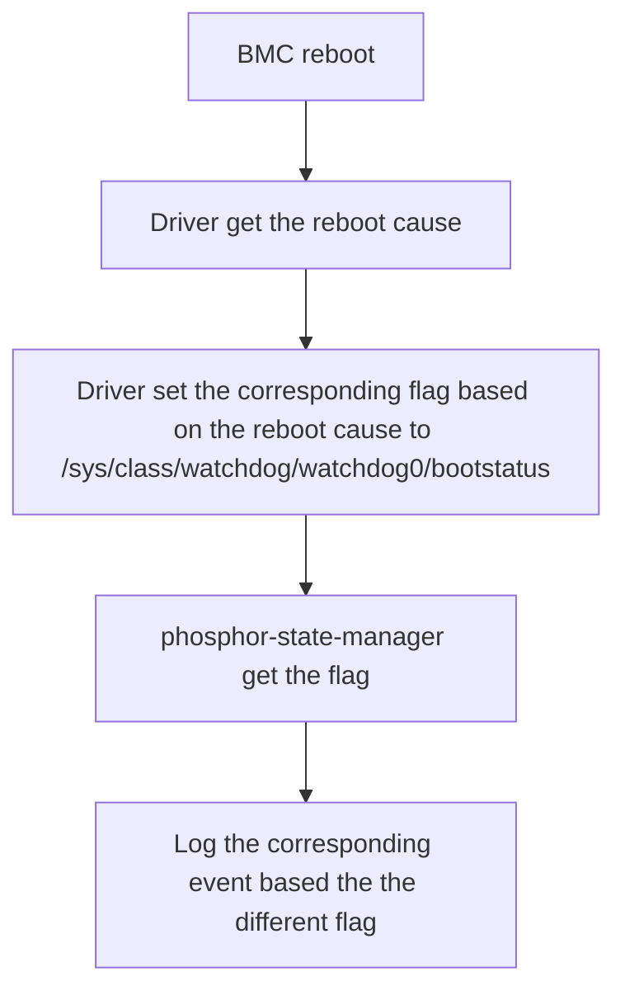

# BMC 開機原因事件記錄

作者：Patrick Lin (patrick_lin_wiwynn)

其他貢獻者：Delphine Chiu (delphinechiu)、Bonnie Lo (bonnielo)、Ricky
Wu (ricky_cx_wu)

建立日期：2024 年 8 月 19 日

## 問題說明

目前 OpenBMC 缺少一套統一的方法，能夠滿足各家供應商記錄不同类型 BMC
重新啟動原因事件記錄的需求。本提案的目的是更新現有的方法，整合更多種類的
BMC 重新啟動原因，以更貼近目前的使用需求。

## 背景與參考資料

在目前的做法中，唯一定義的重新啟動原因是 **WDIOF_EXTERN1** 與
**WDIOF_CARDRESET**，但這不足以因應當前的需求。然而，由於各家供應商的
需求不盡相同，要涵蓋所有可能的重新啟動原因並不切實際。在本次更新中，
我們將增加對數種更常見類型的支援。

## 需求

1. 每家 BMC 供應商都需要提供或更新其驅動程式，以取得對應的 BMC
   重新啟動原因。
2. 每家 BMC 供應商都需要將取得的重新啟動原因結果記錄到指定的路徑。
3. 每家供應商都需要確保重新啟動原因結果的判讀正確無誤。
4. 需要定義新的重新啟動原因類型，以涵蓋各項需求。
5. 修訂某些現有重新啟動原因類型的定義，使其更能代表各自的狀況。
6. 確保基於原始設計的方法能夠良好地適應此變更。

## 建議設計

在 BMC 重新啟動之後，各家 BMC 供應商的驅動程式會先取得重新啟動原因。
接著根據重新啟動原因，將不同的旗標設定到指定的路徑。PSM
（Phosphor-state-manager）從指定路徑讀取旗標，以判定重新啟動原因的類型。
最後，根據判定結果產生對應的事件記錄。

此流程確保了各種 BMC 重新啟動原因都能被準確地記錄與處理，進而提升系統的
可靠性與監控能力。以下為新增內容與變更的詳細說明：

1. 由 BMC 供應商提供的驅動程式：
   - 每家 BMC 供應商都必須提供一個驅動程式，以取得 BMC 重新啟動原因，並將
     結果記錄在指定的位置。

2. **Software Reset** 重新啟動原因類型的定義與辨識：
   - 此項目仍在討論中，更多細節請參考以下連結：
     <https://lore.kernel.org/all/9565c496-44d8-4214-8038-931926210d0f@roeck-us.net/>

3. 修訂 **WDIOF_CARDRESET** 的定義：
   - **WDIOF_CARDRESET** 類型現在將特別用於表示由看門狗（watchdog）所造成的
     重設。

4. 釐清 **Power-on-reset** 的情況：
   - 當 BMC 發生重設，但看門狗驅動程式並未改變 bootstatus 中的旗標（也就是
     維持為 0）時，即表示發生了 **Power-on-reset**。

5. 更新重新啟動原因的判讀：

   | phosphor-state-manager | bootstatus 值      | watchdog 驅動程式                |
   | ---------------------- | ---------------- | -------------------------------- |
   | WDIOF_CARDRESET        | 0x20             | 若由 Watchdog 重設則回傳 0x20    |
   | POR                    | 0x00             | 不做任何事                       |

6. 產生對應的事件記錄：
   - 在判讀重新啟動原因之後，系統應根據判定的類型發出對應的事件記錄。

## 曾考慮的替代方案

在原本的做法中，**WDIOF_CARDRESET** 被用來代表 **POR**（power-on-reset）。
然而，採用新的方法後，我們需要區分看門狗重設與開機重設（power-on reset）。
因此，我們現在使用 **WDIOF_CARDRESET** 來代表看門狗重設，以與既有的核心
文件及驅動程式實作保持一致。

## 影響

1. 各家供應商之間常見的重新啟動原因可以整合，以發出統一的事件記錄。
2. 若有任何功能依賴原本的重新啟動原因，則必須調整程式碼以符合新的定義。

### 組織層面

預期需要修改哪些儲存庫（repository）才能執行此設計？
phosphor-state-manager

## 測試

在各種條件下重新啟動 BMC，並檢查對應的事件記錄是否正確產生。
