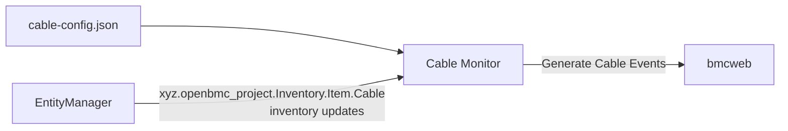

# Cable Monitor

作者：Jagpal Singh Gill <paligill@gmail.com>

建立日期：2024 年 7 月 26 日

## 問題描述

纜線是在系統執行期間可能被有意或意外插入、拔除的元件。此外，針對特定的
硬體配置，實際連接的纜線組態可能需要根據資料中心的部署情況在執行時期
決定。目前 openBMC 中沒有一種服務可以在執行時期設定以監控已連接的纜線，
並將其與預期纜線進行比對。因此，就無法根據此比對結果產生 Redfish 事件。

## 背景與參考

openBMC 透過
[phosphor-gpio-monitor](https://github.com/openbmc/phosphor-gpio-monitor)
提供了 GPIO 監控框架，但此框架的設計過於通用，僅能做到監看某個 GPIO
並執行相關的 systemd target。更多資訊請參閱「替代方案」一節。

## 需求

1. 能夠支援纜線連接關係的執行時期設定。
2. 能夠監控與纜線相關的 inventory 介面事件，並產生對應的 Redfish 事件。

## 提議設計

### Cable Monitor



#### cable.conf

執行時期設定的格式如下 -

##### JSON schema

```json
{
  "$schema": "https://json-schema.org/draft/2020-12/schema",
  "$defs": {
    "CablesDef": {
      "description": "The connected cable definition.",
      "type": "object",
      "properties": {
        "ConnectedCables": {
          "description": "The connected cable list.",
          "type": "array",
          "prefixItems": [
            {
              "type": "string",
              "description": "The name of the cable"
            }
          ]
        }
      },
      "required": ["ConnectedCables"]
    }
  },
  "$ref": "#/$defs/CablesDef"
}
```

##### cablemonitor/cable-config.json 範例

```json
{
  "ConnectedCables": ["Cable_1", "Cable_2"]
}
```

設定中列出了應該要連接並監控的纜線。

這滿足了需求 #1。

#### cable-monitor

cable monitor 負責處理 cable-config.json 檔案並解析其內容。它利用這些
資訊，根據預期的纜線連接關係以及 inventory 項目狀態來發出適當的警示。
此外，它會持續監控纜線 inventory 項目狀態的任何變化，並據以發出或解除
警示。這滿足了需求 #2。

### 錯誤回報

已針對 Redfish 提出
[missing cable](https://gerrit.openbmc.org/c/openbmc/phosphor-dbus-interfaces/+/74397)
事件的定義，其依據為
[event logging design](https://github.com/openbmc/docs/blob/master/designs/event-logging.md)。

### 未來增強

cable monitor 可以進一步擴充，透過 Redfish
[Cable](https://redfish.dmtf.org/schemas/v1/Cable.v1_2_3.json) schema，
使用 CableStatus 屬性來支援執行時期的纜線設定。

## 已考量的替代方案

### phosphor-gpio-monitor

phosphor-gpio-monitor 目前不支援監控像是纜線 inventory 項目這類 inventory
項目，雖然它可以被擴充以支援此功能。然而，這並不符合其原本的目的與命名。
此外，phosphor-gpio-monitor 也不支援執行時期設定。任何加入這些功能的改動，
都會讓它變成一個單體式的 daemon，而且每當有其他 inventory 項目類型時都
必須再度擴充。

## 影響

### API 影響

- 建議以纜線連接事件 api 作為 Redfish 事件的來源。

### 組織面

- 此 repository 是否需要一個新的 repository？不需要。
- 預期需要修改哪些 repository 來實作此設計？`dbus-sensors`
- 列出一份清單，並將所列 repository 的維護者加入 gerrit review。

## 測試

### 單元測試

參考實作的所有功能測試都將使用 GTest 執行。

### 整合測試

產生 Redfish 事件的整合測試，將透過 inventory 項目介面建立與刪除纜線
inventory 來進行。
