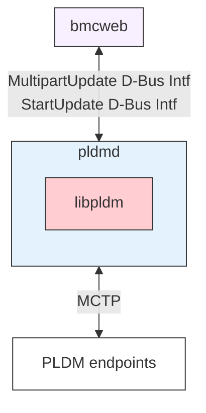

# 程式碼更新設計

作者：Jagpal Singh Gill <paligill@gmail.com>

其他貢獻者：

- Deepak Kodihalli <deepak.kodihalli.83@gmail.com> @dkodihal
- Tom Joseph <rushtotom@gmail.com> @tomjose

建立日期：2023 年 8 月 4 日

最後更新：2025 年 8 月 29 日

## 問題描述

本節說明在
[phosphor-bmc-code-mgmt](https://github.com/openbmc/phosphor-bmc-code-mgmt)
中發現的限制。

1. 目前的程式碼更新流程相當複雜，因為它涉及 3 個不同的 daemon ──
   Image Manager、Image Updater 與 Update Service。
2. 更新呼叫流程沒有明確的介面，反而依賴 Image Manager 在 /tmp/images
   中探索到新檔案。
3. 透過 Redfish POST 的映像檔會由 BMCWeb 下載到 /tmp/images，
   這需要檔案系統的寫入權限。這帶來了安全風險。
4. 目前的設計不支援不同韌體的平行升級
   ([Issue](https://github.com/openbmc/bmcweb/issues/257))。

## 背景與參考資料

- [phosphor-bmc-code-mgmt](https://github.com/openbmc/phosphor-bmc-code-mgmt)
- [Software DBus Interface](https://github.com/openbmc/phosphor-dbus-interfaces/tree/master/yaml/xyz/openbmc_project/Software)
- [Code Update Design](https://github.com/openbmc/docs/tree/master/architecture/code-update)
- [PLDM for Firmware Update Specification](https://www.dmtf.org/sites/default/files/standards/documents/DSP0267_1.3.0.pdf)
- [Redfish Firmware Update White Paper](https://www.dmtf.org/sites/default/files/standards/documents/DSP2062_1.0.2.pdf)

## 需求

1. 在給定韌體映像檔與更新設定檔的情況下，能夠啟動更新。
   - 更新設定檔必須能夠指定何時套用映像檔，例如立即套用、裝置重設時套用，
     或依需求套用。

2. 能夠取得更新的進度與狀態。
3. 能夠產出符合
   [Redfish UpdateService](https://redfish.dmtf.org/schemas/v1/UpdateService.v1_11_3.json)
   的介面實作
4. 具備 DBus 存取權限的非特權 daemon 應該能夠接受並執行韌體更新。
5. 更新請求應該立即回應，讓用戶端可以在更新進行期間查詢狀態。
6. 所有錯誤都應該回傳給用戶端。
7. 能夠支援不同類型硬體元件的更新，例如 CPLD、NIC、BIOS、BIC、
   PCIe 交換器等。
8. 設計上不得強制限制只能選擇特定的映像檔格式。
9. 能夠更新相同類型、但執行不同韌體映像檔的多個硬體元件，例如主機板上有
   兩個 CPLDx 實例，一個執行 functionX、另一個執行 functionY，
   因此執行不同的韌體映像檔。
10. 能夠平行更新多個元件。
11. 在程式碼更新進行期間，能夠限制重要的系統動作，例如對正在更新的
    實體進行重開機。
12. 當未指定 Targets 時，能夠使用多部件（multi part）映像檔來更新元件。
13. 能夠依照多部件映像檔格式中所定義的順序，對裝置進行元件更新排序。

## 建議設計

### 建議的端到端流程

```mermaid
sequenceDiagram;
participant CL as Client
participant BMCW as BMCWeb
participant CU as <deviceX>CodeUpdater<br> ServiceName: xyz.openbmc_project.Software.<deviceX>

% Bootstrap Action for CodeUpdater
note over CU: Get device access info from<br> /xyz/openbmc_project/inventory/system/... path
note over CU: Swid = <DeviceX>_<RandomId>
CU ->> CU: Create Interface<br> xyz.openbmc_project.Software.Update<br> at /xyz/openbmc_project/Software/<SwId>
CU ->> CU: Create Interface<br> xyz.openbmc_project.Software.Version<br> at /xyz/openbmc_project/Software/<SwId>
CU ->> CU: Create Interface<br>xyz.openbmc_project.Software.Activation<br> at /xyz/openbmc_project/Software/<SwId> <br> with Status = Active
CU ->> CU: Create functional association <br> from Version to Inventory Item

CL ->> BMCW: HTTP POST: /redfish/v1/UpdateService/update <br> (Image, settings, RedfishTargetURIArray)

loop For every RedfishTargetURI
  note over BMCW: Map RedfishTargetURI /redfish/v1/UpdateService/FirmwareInventory/<SwId> to<br> Object path /xyz/openbmc_project/software/<SwId>
  note over BMCW: Get serviceName corresponding to the object path <br>from mapper.
  BMCW ->> CU: StartUpdate(Image, ApplyTime)

  note over CU: Swid = <DeviceX>_<RandomId>
  note over CU: ObjectPath = /xyz/openbmc_project/Software/<SwId>
  CU ->> CU: Create Interface<br>xyz.openbmc_project.Software.Activation<br> at ObjectPath with Status = NotReady
  CU -->> BMCW: {ObjectPath, Success}
  CU ->> CU: << Delegate Update for asynchronous processing >>

  par BMCWeb Processing
      BMCW ->> BMCW: Create Matcher<br>(PropertiesChanged,<br> xyz.openbmc_project.Software.Activation,<br> ObjectPath)
      BMCW ->> BMCW: Create Matcher<br>(PropertiesChanged,<br> xyz.openbmc_project.Software.ActivationProgress,<br> ObjectPath)
      BMCW ->> BMCW: Create Task<br> to handle matcher notifications
      BMCW -->> CL: <TaskNum>
      loop
          BMCW --) BMCW: Process notifications<br> and update Task attributes
          CL ->> BMCW: /redfish/v1/TaskMonitor/<TaskNum>
          BMCW -->>CL: TaskStatus
      end
  and << Asynchronous Update in Progress >>
      note over CU: Verify Image
      break Image Verification FAILED
        CU ->> CU: Activation.Status = Invalid
        CU --) BMCW: Notify Activation.Status change
      end
      CU ->> CU: Activation.Status = Ready
      CU --) BMCW: Notify Activation.Status change

      CU ->> CU: Create Interface<br> xyz.openbmc_project.Software.Version<br> at ObjectPath
      CU ->> CU: Create Interface<br>xyz.openbmc_project.Software.ActivationProgress<br> at ObjectPath
      CU ->> CU: Create Interface<br> xyz.openbmc_project.Software.ActivationBlocksTransition<br> at ObjectPath
      CU ->> CU: Activation.Status = Activating
      CU --) BMCW: Notify Activation.Status change
      note over CU: Start Update
      loop
          CU --) BMCW: Notify ActivationProgress.Progress change
      end
      note over CU: Finish Update
      CU ->> CU: Activation.Status = Active
      CU --) BMCW: Notify Activation.Status change
      CU ->> CU: Delete Interface<br> xyz.openbmc_project.Software.ActivationBlocksTransition
      CU ->> CU: Delete Interface<br> xyz.openbmc_project.Software.ActivationProgress
      alt ApplyTime == Immediate
          note over CU: Reset Device
          CU ->> CU: Update functional association to System Inventory Item
          CU ->> CU: Create Interface<br> xyz.openbmc_project.Software.Update<br> at ObjectPath
          note over CU: Delete all interfaces on previous ObjectPath
      else
          note over CU: Create active association to System Inventory Item
      end
  end
end
```



- 每種可升級的硬體類型可能各有一個獨立的 daemon（依上述流程中的
  \<deviceX>）負責處理其更新程序，並需要實作下一節所述的建議介面。
  這滿足了 [Requirement# 6](#requirements)。
- 由於只會有一個 daemon 處理更新（而非三個），所需的握手協調（hand
  shaking）較少，因此解決了 [Issue# 1](#problem-description) 與
  [Requirement# 4](#requirements)。

### 建議的 D-Bus 介面

程式碼更新的 DBus 介面將包含以下項目 ──

| 介面名稱                                                                                                                                                                                         | 既有/新增 |                                                   用途                                                   |
| :----------------------------------------------------------------------------------------------------------------------------------------------------------------------------------------------------- | :----------: | :---------------------------------------------------------------------------------------------------------: |
| [xyz.openbmc_project.Software.Update](https://gerrit.openbmc.org/c/openbmc/phosphor-dbus-interfaces/+/65738)                                                                                           |     新增      |                                           提供更新方法                                            |
| [xyz.openbmc_project.Software.MultipartUpdate](https://gerrit.openbmc.org/c/openbmc/phosphor-dbus-interfaces/+/78905)                                                                                  |     新增      | 用於識別多部件更新器（multi part updater）的介面，可依據多部件映像檔格式執行程式碼更新。 |
| [xyz.openbmc_project.Software.Version](https://github.com/openbmc/phosphor-dbus-interfaces/blob/master/yaml/xyz/openbmc_project/Software/Version.interface.yaml)                                       |   既有   |                                            提供版本資訊                                            |
| [xyz.openbmc_project.Software.Activation](https://github.com/openbmc/phosphor-dbus-interfaces/blob/master/yaml/xyz/openbmc_project/Software/Activation.interface.yaml)                                 |   既有   |                                         提供啟用（activation）狀態                                          |
| [xyz.openbmc_project.Software.ActivationProgress](https://github.com/openbmc/phosphor-dbus-interfaces/blob/master/yaml/xyz/openbmc_project/Software/ActivationProgress.interface.yaml)                 |   既有   |                                   提供啟用進度百分比                                   |
| [xyz.openbmc_project.Software.ActivationBlocksTransition](https://github.com/openbmc/phosphor-dbus-interfaces/blob/master/yaml/xyz/openbmc_project/Software/ActivationBlocksTransition.interface.yaml) |   既有   |                     表示在更新進行期間對狀態轉換設下的屏障（barrier）                     |
| [xyz.openbmc_project.Software.RedundancyPriority](https://github.com/openbmc/phosphor-dbus-interfaces/blob/master/yaml/xyz/openbmc_project/Software/RedundancyPriority.interface.yaml)                 |   既有   |                         為 version 介面提供冗餘優先順序                          |
| [xyz.openbmc_project.Software.Asset](https://github.com/openbmc/phosphor-dbus-interfaces/tree/master/yaml/xyz/openbmc_project/Software/Asset.interface.yaml)                                           |     新增      |                             提供製造商（Manufacturer）與發行日期（Release Date）資訊                              |

引入 xyz.openbmc_project.Software.Update 介面可簡化更新呼叫流程，
因此解決了 [Issue# 2](#problem-description) 與
[Requirement# 1 & 2](#requirements)。

#### 關聯性（Association）

`running`：從 xyz.openbmc_project.Inventory.Item 到
xyz.openbmc_project.Software.Version 的 `running` 關聯，代表該關聯
清單項目（inventory item）目前功能正常或正在執行的軟體版本。
`ran_on` 則是對應的反向關聯。

`activating`：從 xyz.openbmc_project.Inventory.Item 到
xyz.openbmc_project.Software.Version 的 `activating` 關聯，代表該關聯
清單項目已啟用（但尚未執行）的軟體版本。一個清單項目可能有多個啟用中的
版本，例如在 A/B 冗餘模型的情況下會有 2 個關聯的 flash bank，而
xyz.openbmc_project.Software.RedundancyPriority 介面為每一個定義其
優先順序。

對於支援暫存（staging）的 A/B 冗餘模型，
xyz.openbmc_project.Software.Activation.Activations.Staged 可用來定義
目前哪個軟體版本處於暫存狀態。

`activated_on` 則是對應的反向關聯。

### 將映像檔保留在記憶體中

映像檔將保留在記憶體中，並使用檔案描述元（file descriptor）而非檔案路徑
傳遞給 \<deviceX>CodeUpdater。實作上必須監控適當的記憶體上限，以避免平行
更新耗盡 BMC 的記憶體。

### 將錯誤傳遞給用戶端

xyz.openbmc_project.Software.Update.StartUpdate 的回傳值會將與初始
設定以及映像檔中繼資料/標頭解析相關的任何錯誤回傳給使用者。在更新程序
期間發生的任何非同步錯誤，將透過啟用失敗狀態（failed activation
status）通知，對應到該更新相關聯的失敗工作（failed task）。此外，會建立
一個 phosphor-logging 事件，並透過
[Redfish Log Service](https://redfish.dmtf.org/schemas/v1/LogService.v1_4_0.json)
回傳給用戶端。

建議使用 [Redfish
events](https://gerrit.openbmc.org/q/topic:%22fw-update-events%22) 來處理
不同的更新階段，這些階段將透過
[Redfish Event Services](https://redfish.dmtf.org/schemas/v1/EventService.v1_10_0.json)
回報。

### 韌體映像檔格式

映像檔解析將由 \<deviceX>CodeUpdater 執行，由於 \<deviceX>CodeUpdater
可能是裝置專用的 daemon，廠商可以為韌體映像檔選擇任何映像檔格式。
這滿足了 [Requirement# 7](#requirements)。

#### PLDM 映像檔封裝

PLDM for
[Firmware Update Specification](https://www.dmtf.org/sites/default/files/standards/documents/DSP0267_1.3.0.pdf)
提供了一種標準化的映像檔封裝格式，同時包含標準描述元與使用者自訂描述元。
此格式也可用於為非 PLDM 裝置封裝韌體更新映像檔。對於這類裝置，
CodeUpdater 會解析 entity manager 設定檔，以識別適用的 PLDM 描述元，
其中可能包含但不限於以下項目 ──

| PLDM 封裝描述元 | 描述元類型 |                                                                                           說明                                                                                            |
| :---------------------: | :-------------: | :----------------------------------------------------------------------------------------------------------------------------------------------------------------------------------------------: |
|   IANA Enterprise ID    |    標準     |                                       硬體廠商的 [IANA Enterprise Id](https://www.iana.org/assignments/enterprise-numbers/enterprise-numbers)                                        |
|       ASCII Model       |    標準     | 相容的硬體名稱 (com.\<vendor\>.Hardware.\<XXX\>)，由硬體廠商在 [phosphor-dbus-interfaces](https://github.com/openbmc/phosphor-dbus-interfaces/tree/master/yaml/com) 中指定。 |

#### Entity Manager 設定檔

entity manager 設定檔可以在主機板設定中提供與韌體相關的資訊，可用於韌體
驗證以及對裝置存取細節建模。這些 D-Bus 物件隨後可由 CodeUpdater 服務
取用，以管理相關韌體實體的更新。

關於通用的韌體資訊定義，請
[參考](https://gerrit.openbmc.org/c/openbmc/entity-manager/+/75947)

以下範例即是此定義針對 i2c CPLD 裝置韌體的一個實例。

```json
"Exposes": [
  ...
  {
    "Name": "MB_LCMX02_2000HC",
    "Type": "CPLDFirmware",
    ...
    "FirmwareInfo" :
    {
      "VendorIANA": 0000A015,
      "CompatibleHardware": "com.meta.Hardware.Yosemite4.MedusaBoard.CPLD.LCMX02_2000HC"
    }
    ...
  },
  ...
]
```

- `Name`：韌體實體實例的名稱。
- `Type`：CodeUpdater 服務使用此欄位來決定它應該處理哪些韌體 EM 設定檔。
- `VendorIANA`：此欄位對應到 PLDM 封裝標頭中的 `IANA Enterprise ID` 描述元。
- `CompatibleHardware`：此欄位對應到 PLDM 封裝標頭中的 `ASCII Model` 描述元。

### 更新前與更新後條件

某些裝置更新可能需要在更新程序之前或之後執行特定的設定或動作。更新後
動作的其中一個例子是裝置重設。雖然對某些更新器而言，這些動作可以整合到
更新程序中，但通常最好的做法是將它定義為韌體更新程序中的結構化掛勾
（hooks）。本節旨在為適當的更新器建立這類掛勾。

#### 用於設定的 JSON schema

Code Updater daemon 可以設定為執行平台專屬的更新前/更新後 systemd
target，其定義如下列 JSON schema 定義所述：

```json
{
  "$schema": "http://json-schema.org/draft-04/schema#",
  "type": "array",
  "items": [
    {
      "description": "The definition for the pre and post update targets",
      "type": "object",
      "properties": {
        "Identifier": {
          "type": "string",
          "description": "The unique identifier for a device or a component."
        },
        "PreUpdateTarget": {
          "type": "string",
          "description": "The systemd target service that should be run before starting an update."
        },
        "PostUpdateTarget": {
          "type": "string",
          "description": "The systemd target service that should be run after an update has finished successfully."
        }
      },
      "additionalProperties": false
    }
  ]
}
```

- `Identifier` 對應到前文各節中所定義的 `DeviceX`。

#### 設定範例

```json
[
  {
    "Identifier": "Device1",
    "PostUpdateTarget": "ABC_PostUpdate.service"
  },
  {
    "Identifier": "Device2_ComponentX",
    "PreUpdateTarget": "XYZ_PreUpdate.service",
    "PostUpdateTarget": "XYZ_PostUpdate.service"
  },
  {
    "Identifier": "Device3_ComponentY",
    "PreUpdateTarget": "JKL_PreUpdate.service",
    "PostUpdateTarget": "JKL_PostUpdate.service"
  }
]
```

#### 執行更新前/更新後服務

如果某個 `Identifier` 未指定更新前或更新後服務，則會被跳過。但若有指定
服務，則會被觸發，而若啟動失敗，則會依適當的程序執行錯誤處理。

若要啟動這些服務，CodeUpdater 會使用 systemd 服務所暴露的
org.freedesktop.systemd1.Manager 介面中的
[StartUnit](https://www.freedesktop.org/software/systemd/man/latest/org.freedesktop.systemd1.html)
方法。

#### 處理更新前/更新後服務的完成

對於被觸發的更新前/更新後服務，CodeUpdater 會透過向
org.freedesktop.systemd1.Manager 介面註冊
[JobRemoved](https://www.freedesktop.org/software/systemd/man/latest/org.freedesktop.systemd1.html)
訊號來等待其完成。CodeUpdater 會依回傳的狀態決定要讓更新失敗或繼續進行，
並據以更新啟用狀態。

systemd 對於它從佇列中取出的每個工作都只會發出 `JobRemoved` 一次，無論
該工作是執行完成、啟動失敗、被取消或被另一個工作取代，或是因逾時而終止。
因此，`StartUnit` 所回傳的工作最終一定會伴隨這樣一個訊號，所以 CodeUpdater
不需要自訂的逾時機制就能觀察到完成。只有工作結果 `done` 會被視為成功；
任何其他結果，例如 `failed`、`timeout` 或 `canceled`，都會使條件失敗。

#### 處理卡死的工作

為了處理可能無限卡死的工作，更新前與更新後服務可以自行限制其執行時間，
這有助於終止卡死的服務，並透過 JobRemoved 訊號傳遞指定的狀態。要使用的
指令取決於服務類型：`TimeoutStartSec` 會限制 `Type=oneshot` 服務的時間，
而對這類服務 `RuntimeMaxSec` 會被忽略；至於可到達 active 狀態的服務，
則由 `RuntimeMaxSec` 來限制其執行時間。

限制執行時間是服務本身的責任，因為 CodeUpdater 不會套用自訂的逾時。
一個可能卡死卻未設定此上限的服務，會讓更新無限期等待。

### 多部件映像檔

多部件映像檔在一個映像檔封裝中包含多個元件映像檔。PLDM 映像檔就是
多部件映像檔格式的一個例子。有時候，對於多部件裝置而言並不存在具體的
實體韌體裝置，而是韌體裝置本身由多個實體元件組成，其中每個元件可能都有
自己的元件映像檔。在這種情況下，\<deviceX>CodeUpdater 可以為該韌體裝置
建立一個邏輯清單項目（logical inventory item）。在執行韌體裝置更新時，
用戶端可以以該邏輯韌體裝置為目標，而它進一步知道如何為所提供的元件映像檔
更新對應的子元件。使用者也可以提供以元件為節點（head node）的映像檔封裝，
來更新特定的元件。\<deviceX>CodeUpdater 可以實作所需的邏輯，來驗證所提供的
映像檔是否以其自身（及其子元件）為目標。

### 無 Targets 的多部件映像檔處理

若要透過多部件映像檔來處理韌體更新、且不使用明確的更新目標（update
targets），則該服務必須實作
xyz.openbmc_project.Software.MultipartUpdate 介面。系統只允許此介面的
單一實例。若未提供 targets，bmcweb 會尋找暴露此介面的服務，並在其相關聯的
物件路徑上呼叫 StartUpdate 方法。

PLDM 封裝是多部件映像檔格式的一個例子。在應用層，pldmd daemon 同時實作了
xyz.openbmc_project.Software.MultipartUpdate 與
xyz.openbmc_project.Software.Update D-Bus 介面。pldmd 在收到 PLDM 封裝後，
會解析其內容、套用 PLDM Type 5 規範所定義的元件比對演算法，並為相關的
PLDM 裝置啟動韌體更新，同時確保每個韌體裝置的元件更新依序進行。此實作
未涵蓋可用 PLDM 封裝同時更新 PLDM 與非 PLDM 裝置的情境。

pldmd 實作了標準介面：

- `xyz.openbmc_project.Software.MultipartUpdate`
- `xyz.openbmc_project.Software.Update`
- `xyz.openbmc_project.Software.Activation`
- `xyz.openbmc_project.Software.ActivationProgress`



### 更新相同類型的多個裝置

- 對於相同類型的裝置，擴充 Dbus 路徑以指定裝置實例，例如
  /xyz/openbmc_project/Software/\<deviceX>\_\<InstanceNum>\_\<SwId>。
  所有相關的介面都可以存在於此路徑上，而 xyz.openbmc_project.Software.Update.StartUpdate
  會回傳相同的這個路徑。

這滿足了 [Requirement# 9](#requirements)。

### 平行升級

- 不同類型的硬體元件：

  不同類型硬體元件的升級可以由不同的 `<deviceX>CodeUpdater` daemon
  處理，或者由單一 daemon 處理具有共同特性的硬體元件，例如 PLDMd
  可以處理使用 PLDM 規範的裝置更新。這類更新可以由 BMCWeb 平行呼叫，
  並透過不同的工作（task）來追蹤。

- 相同類型的硬體元件：

  BMCWeb 會針對每個硬體實例所對應的不同 D-Bus 路徑觸發
  xyz.openbmc_project.Software.Update.StartUpdate。關於 D-Bus
  路徑的更多細節，請參考
  [Update multiple devices of same type](#update-multiple-devices-of-same-type)。

這滿足了 [Requirement# 9](#requirements)。

### 不中斷的更新

`ActivationBlocksTransitions` 介面會在版本更新對應的特定 D-Bus
路徑上建立，有助於阻擋來自重要系統動作（例如重開機）的任何干擾。此介面
反過來可以啟動與停止服務，例如 Boot Guard Service，以防止此類干擾。

此外，當某個裝置正在升級時，可能需要停用該裝置的感測器掃描。為達成此事，
感測器掃描流程可以檢查該清單項目相關聯的 `Version` DBus
路徑上是否存在 `ActivationBlocksTransitions` 介面。若此介面存在，
則可以透過回傳相關的錯誤（例如 `EBUSY`）給用戶端來跳過該裝置的感測器掃描。
另一種替代做法是只有在感測器掃描逾時時才檢查
`ActivationBlocksTransitions` 介面是否存在。這不會影響感測器掃描的
平均情況下效能，只會影響裝置忙碌時的最壞情況，例如更新進行中。

## 曾考慮的替代方案

### 使用全域 Software Manager 的集中式設計

單一 SoftwareManager 與 BMCWeb 溝通，並在其上為系統內所有硬體元件於不同
DBus 路徑 hosting 所有介面，例如 Version、Activation、Progress。
Software Manager 保留系統內各種硬體更新服務清單，並依更新請求啟動它們。
這些依需求啟動的服務更新硬體以及由 Software Manager hosting
的介面，然後結束。

#### 優點

- 多數的 DBus 介面都由 Software Manager 實作，廠商只需要寫最少的程式碼，
  依狀態與進度變更這些介面的屬性。
- 在正常運作情況下（沒有進行中的更新），只有 Software Manager 會在執行。

#### 缺點

- 需要一個共用的映像檔格式，因為 Software Manager
  必須解析並驗證映像檔才能建立介面。
- 設計上的限制，因為在系統啟動時需要從硬體取得目前執行的版本。因此
  Software Manager 必須在系統啟動時啟動每個更新 daemon
  以取得執行中的版本。

### 狀態與進度的拉取（pull）模型

所建議的方案使用推送（push）模型，將狀態與進度更新非同步推播給 BMCWeb。
另一種替代方案是使用拉取（pull）模型，讓 Update 介面具有取得狀態與進度的
get 方法（例如 getActivationStatus 與 getActivationProgress）。

#### 優點

- 伺服器不必維護 Dbus matcher
  ([Issue](https://github.com/openbmc/bmcweb/issues/202))。
- 伺服器實作較簡單，因為不需要非同步處理常式。

#### 缺點

- 伺服器仍然需要維護一些資訊，才能將用戶端的工作狀態請求對應到 Dbus 路徑
  `/xyz/openbmc_project/Software/<deviceX>`，以便呼叫 getActivationStatus
  與 getActivationProgress。
- 前述的 [issue](https://github.com/openbmc/bmcweb/issues/202)
  較屬於實作問題，可以透過實作變更來解決。
- 目前啟用與進度介面正被用於
  [許多伺服器](#organizational)。未來若要將流程統一為單一方式，將需要在
  那些地方全部把推送模型改為拉取模型。以目前的建議而言，唯一的變更會是在
  更新呼叫流程。

## 影響

引入新的 DBus API 會暫時讓伺服器有兩種呼叫流程。伺服器（BMCWeb、IPMI
等）最初可以同時支援兩套程式碼堆疊。當所有程式碼更新 daemon
都轉移到新流程後，伺服器會被改為只支援新的 API 堆疊。由於設計遵循 Redfish
UpdateService，因此對使用者 API 沒有影響。

## 組織面

### 此設計是否需要新的 repository？

需要。會有裝置傳輸層級的 repository，使用相似傳輸層的多個
\<deviceX>CodeUpdater 可以存在於同一個 repository 中。例如，所有使用
PMBus 的裝置可以有一個共用的 repository。

### 誰會是這個 repository 的初始維護者？

Meta 將為以下裝置提出 repository，而 `Jagpal Singh Gill` 與
`Patrick Williams` 將是它們的維護者。

- VR Update
- CPLD Update

### 預期需要修改哪些 repository 才能執行此設計？

需要在以下 repository 進行變更，以納入用於更新呼叫的新介面 ──

| Repository                                                                      | 變更負責人 |
| :------------------------------------------------------------------------------ | :----------------- |
| [phosphor-bmc-code-mgmt](https://github.com/openbmc/phosphor-bmc-code-mgmt)     | Jagpal Singh Gill  |
| [BMCWeb](https://github.com/openbmc/bmcweb)                                     | Jagpal Singh Gill  |
| [phosphor-host-ipmid](https://github.com/openbmc/phosphor-host-ipmid)           | Jagpal Singh Gill  |
| [pldm](https://github.com/openbmc/pldm/tree/master/fw-update)                   | Jagpal Singh Gill  |
| [openpower-pnor-code-mgmt](https://github.com/openbmc/openpower-pnor-code-mgmt) | Adriana Kobylak    |
| [openbmc-test-automation](https://github.com/openbmc/openbmc-test-automation)   | Adriana Kobylak    |

注意：由於
[phosphor-psu-code-mgmt](https://github.com/openbmc/phosphor-psu-code-mgmt)
的程式碼看起來未被使用，因此不追蹤其變更。

## 測試

### 單元測試

參考實作的所有功能測試將使用 GTest 執行。

### 整合測試

涉及伺服器（例如 BMCWeb）的端到端整合測試將使用
openbmc-test-automation 涵蓋。
