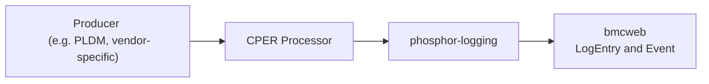
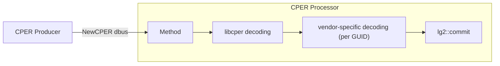

# CPER 事件記錄

作者：[Patrick Williams][patrick-email] `<stwcx>`

其他貢獻者：

- [Jayanth Othayoth][jayanth-email] `<Jayanth>`
- [Brad Bishop][brad-email] `<radsquirrel>`

[patrick-email]: mailto:patrick@stwcx.xyz
[jayanth-email]: mailto:ojayanth@gmail.com
[brad-email]: mailto:bradleyb@fuzziesquirrel.com

建立日期：2026-08-10

## 問題描述

產業標準 [UEFI Specification][uefi-spec] 定義了一種 ["Common Platform Error
Record (CPER)"][cper-record-spec]，作為擷取、描述與回報平台硬體錯誤的標準化、
統一格式。許多硬體實作，例如 CPU、GPU 與 NIC，開始會產生 CPER。平台擁有者期望
能取得這些 CPER，以便進行系統診斷與修復。

OpenBMC 接手了 [`libcper`][libcper]，這是一個用於解析 CPER 二進位資料的函式庫，
目前有多家公司正在貢獻額外（OEM）CPER 區段的解碼功能。誠如 [`libcper` 的][libcper-proposal]
[設計提案][libcper-proposal]所述，該提案的範圍相當狹窄：

> 雖然這份設計是更大範圍設計的一部分……但本文件僅要求第一步：建立一個共用
> 函式庫實作。

近期有數次嘗試要擴充 OpenBMC 平台的 CPER 功能，但大多只是零碎的增強。本文件
提出對 CPER 完整生命週期的端到端支援：從產生端軟體（例如 PLDM 或廠商專屬的
支援）一路到透過 Redfish 標準的 [Event][redfish-event-ref] 與
[LogEntry][redfish-logentry-ref] 結構描述暴露出來。

## 背景與參考資料

### 整體流程

以下（"..."）即是本提案試圖解決的問題：


### OpenBMC 中的先前做法

過去曾有眾多嘗試要實作某種程度的 CPER 支援。這些嘗試絕大多數都未被合併，也
沒有一套完整連貫的端到端設計。唯一被合併的，是 `pldm` 中將原始檔案放入特定
目錄（`/var/cper`）的一些支援，而 OpenBMC 並沒有進一步消費它的支援。

- [AMD BMC RAS][amd-bmc-ras] 設計提案。
- [CPER Repository][cper-repository] 設計提案。
- 在 `bmcweb` 中的 [Arm CPER decoding][arm-cper-decode]。
- 在 `bmcweb` 中的 [FaultLog Attachment][fault-log-attachment]。
- 提議在 [`phosphor-debug-collector`][cper-pdc] 與 [`bmcweb`][cper-pdc-bmcweb]
  中的 CPER 實作。
- 在 [`pldm`][cper-pldm] 中的原始 CPER 檔案。

[amd-bmc-ras]: https://gerrit.openbmc.org/c/openbmc/docs/+/68440
[arm-cper-decode]: https://gerrit.openbmc.org/c/openbmc/bmcweb/+/92341
[cper-pdc-bmcweb]: https://gerrit.openbmc.org/c/openbmc/bmcweb/+/55839
[cper-pdc]:
  https://gerrit.openbmc.org/c/openbmc/phosphor-debug-collector/+/55934
[cper-pldm]: https://gerrit.openbmc.org/c/openbmc/pldm/+/74490
[cper-repository]: https://gerrit.openbmc.org/c/openbmc/docs/+/83766
[fault-log-attachment]: https://gerrit.openbmc.org/c/openbmc/bmcweb/+/91085

### CPER 內容

Redfish 的 LogEntry 或 Event 可以包含一個 `"CPER"` 屬性，其資料可如下所示。
依 Redfish 目前的文件，「標準」資料非常少，因此大部分資料都交由實作端處理
（放在 Oem 屬性中）。以下內容是虛構的，但符合規範。

```jsonc
{
  "CPER": {
    "NotificationType": "039b42ef-be02-4d20-9c23-64714e17ea4d",
    "SectionType": "9876eead-de3c-4eaa-919d-cc614131d6d1",
    "Oem": {
      "ContosoElectronics": {
        "@odata.type": "#ContosoLogEntryExtensions.v1_0_0.CperFields",
        "ProcessorId": 0,
        "ErrorType": "CacheError",
        "PhysicalAddress": "0x00000000FED00000",
        "ValidationBits": "0x0000000000000007",
      },
    },
  },
}
```

在 OpenBMC 內部，`libcper` 可用於解析 CPER 二進位資料，且確實會產生
[JSON 輸出][libcper-output]，但其結構與 Redfish 並不對齊，需要進行轉換。這
可能必須定義 `libcper` 或 OpenBMC 的 OEM odata 結構描述。

[libcper-output]: https://github.com/openbmc/libcper/tree/main/examples

對於 CPER 的用途似乎存在一些不同看法，因為在某種程度上 CPER 只是一種硬體資料
的封裝格式。在目前的 `libcper` 中，所有範例都很小（約 1KiB），但有一些
[提案中的廠商 GUID][large-cper-example] 仍未被合併，它們的區段會包含數萬個
暫存器。

在本設計的範圍內，我們區分「小型」與「大型」CPER。小型 CPER（小於 16KiB）
預期多半是硬體所產生、已被充分理解的錯誤報告，可直接用於對故障系統進行修復與
補救。大型 CPER（16KiB 或以上）預期多半是未知的錯誤，需要硬體廠商的支援才能
進一步分析。大型 CPER 應該以傳統「crashdump」支援的方式來處理，即使 CPER 是
用作封裝格式，並且應該使用 phosphor-debug-collector 的機制。小型 CPER 是本
文件的目標。

[large-cper-example]:
  https://gerrit.openbmc.org/c/openbmc/libcper/+/75550/1/edk/Cper.h

### 專有內容

很難提出具體的佐證資料，但我們應該體認到並非所有硬體廠商都在貢獻
`libcper` 程式碼庫。目前只有三家晶片廠商是活躍的貢獻者，全都是 Arm 硬體。
AMD 在其提案中[提及][amd-bmc-ras]過 CPER 支援，但並未貢獻。此外，晶片廠商
很可能只在其晶片全面上市後（甚至永不）才會在 `libcper` 中貢獻支援。將 CPER
支援限制於只有已貢獻到 `libcper` 的晶片，會讓系統整合者背負沉重的負擔，他們
必須自行維護 `libcper` 及／或 OpenBMC 軟體堆疊中某些部分的補丁，才能從其
系統中的晶片取得可靠的錯誤回報。

CPER 已有一種機制可讓晶片廠商在 CPER 中定義晶片專屬的區段：廠商 GUID。本
提案將建議在 OpenBMC 堆疊中為廠商 GUID 提供一流支援，就如同我們為 IPMI
及／或 PLDM 提供 OEM 指令的支援一樣。這能鼓勵整體上採用 OpenBMC 堆疊進行
診斷，同時為那些無法克服將晶片診斷所有細節開源之非技術層面的廠商與系統整合者
提供一個退路。

此處的重點在於：與強迫所有晶片廠商貢獻到上游相比，我們主張以務實的決定去支援
一套定義明確的閉源廠商 GUID API，對 OpenBMC 社群更為有利。

## 需求

- 提供一套端到端的框架，用於在 BMC 內儲存 CPER、將其解碼為一致的格式、透過
  Redfish 暴露，以及透過推送（Redfish Event）與拉取（Redfish LogEntry）兩種
  機制進行回報。
  - 特別處理小於 16KiB 的「小型」CPER。

- 提供一種機制，讓 CPER 提供者（例如 PLDM）能從硬體或衛星管理控制器收集
  CPER，並將其加入 BMC 已儲存的 CPER 記錄。

- 善用 `libcper` 來處理常見及／或受支援 GUID 的 CPER 二進位資料。
- 允許廠商針對指定的廠商 GUID 提供另一種 CPER 二進位資料處理方式。

- Redfish 的呈現方式必須符合所有 Redfish 規範，並必須帶有來自有效 Redfish
  訊息登錄（message registry）的 MessageId。
- Redfish 的呈現方式必須能除了已解析的 CPER 資料之外，另行收集原始 CPER
  二進位資料。請參閱 "CPER" 屬性以及關於 "AdditionalDataURI" 的
  [需求][redfish-logentry-cper-ref]。

- 實作必須具備合理的效能特性，與現有的 LogService 及 Event 實作相當(\*)。

(\*) 此處刻意不列出具體的效能指標。主要的焦點在於因應當前的需求建立功能。設計
章節中會討論可以且應該追求的特定最佳化，但只要是主要貢獻者認為「足夠好」的
實作，就應被視為享有「先行者」地位，未來可由有興趣的各方再行最佳化。

## 提案設計

### 高階架構

提案的解決方案由一個新的 CPER 處理常駐程式（daemon）、對 `phosphor-logging`
的一項增強，以及一些直截了見的 `bmcweb` 變更組成。



我們將使用由 `phosphor-logging` 託管的現有事件，並搭配一項 CPER 擴充，以善用
`bmcweb` 中既有的支援來建立可容納 CPER 資料的 LogEntry 與 Event 實例。由於
這些是 `phosphor-logging` 已支援的現有事件，將確保符合 Redfish 規範與 MessageId
需求。同樣地，它也自然會具有與 BMC 事件記錄相似的效能特性，而後者已能容納數千
筆事件。

### 事件擴充

事件記錄設計近期的一項改進是加入了[事件擴充][event-extensions-design]。任何
既有的事件（其已與 Redfish Message Registry 條目相關聯），現在都可以透過來自
dbus 介面的額外資料來「擴充」。該設計展示了一個簡單的 API：

```cpp
    lg2::commit(PlatformError(...).extend(CPER::properties_t{...}));
```

當在 `phosphor-logging` 中完整實作後，任何 dbus 介面都可以作為任何事件的擴充
（前提是它是 `phosphor-logging` 支援作為擴充的介面），這非常適合將 CPER 內容
之類的資料加入既有事件。這裡提案了兩個新的 dbus 介面：

- [`xyz.openbmc_project.Logging.Extension.CPERProcessed`][cperprocessed-gerrit]
- [`xyz.openbmc_project.Logging.Extension.CPERRaw`][cperraw-gerrit]

[cperprocessed-gerrit]:
  https://gerrit.openbmc.org/c/openbmc/phosphor-dbus-interfaces/+/90789
[cperraw-gerrit]:
  https://gerrit.openbmc.org/c/openbmc/phosphor-dbus-interfaces/+/93868
[event-extensions-design]:
  https://github.com/openbmc/docs/blob/master/designs/event-logging.md#event-extensions

### CPERProcessed

"Processed" 介面將包含 Redfish `LogEntry`/`Event` 呈現中，Redfish 的
`NotificationType`、`SectionType` 與 `Oem` 欄位所需的屬性。提案是讓 `Oem`
欄位包含一個 `dict[string, string]`，其中鍵代表某個廠商，字串則是一個符合
Redfish 規範的 JSON 物件（包含 `@odata.type` 參考），如此便能在 `CPER.Oem`
欄位中呈現任何「標準」或廠商專屬的資料，而不需要 `bmcweb` 提供額外支援。

雖然我們通常不在 dbus 中儲存協定專屬的資料，但此處的替代方案是讓資料以「中立
格式」存在，並迫使 `bmcweb` 執行轉換。當主要消費端是 Redfish，且「中立格式」
會導致 `bmcweb` 與廠商專屬 CPER 內容之間自然產生耦合時，這感覺像是多餘的複雜度。
如果未來出現新的格式（例如 Redfish 之後的某個協定），我們希望轉換為該新格式的
工作會是直截了當的，否則屆時可以再決定一個新的 API。這項工作的路線圖很可能要
到很遠的未來。

### CPERRaw

"Raw" 介面將包含原始 CPER 二進位資料的位元組陣列。這份資料也會被擴充到原始的
來源事件中，並由 `phosphor-logging` 託管，讓 `bmcweb` 能取得 CPER 的
AdditionalDataURI 內容。

可能會有人擔心 dbus 是否支援大型陣列，但規範寫道：

> 陣列的長度上限定義為 2 的 26 次方，即 [64 MiB]……

所有 dbus broker 與 sd-bus 的實作似乎都支援這個長度。我們可能會發現儲存大型
陣列會對 `org.freedesktop.DBus.Properties.GetAll` 之類的 dbus 介面造成限制，
而作為一種最佳化，我們也可能定義一個 `GetCPERRaw` 介面，由 `phosphor-logging`
託管來取代 `CPERRaw`，其中的方法會透過 `memfd` 支援的檔案描述元來取得陣列資料。

關於效能有幾點重要考量：

1. 事件建立是單一且相對不頻繁的操作。我們並不預期要支援每秒建立數千筆 CPER
   記錄的系統，因為那樣很快就會把事件記錄塞滿。

2. 透過 Redfish 讀取事件可能相當頻繁，因為有些用戶端可能會在指定的時間間隔
   讀取所有事件記錄。

基於此，最佳化的最初重點應放在 (2) 而非 (1)。

### `phosphor-logging` 資料庫

`phosphor-logging` 近期已完成一項工作，將 `phosphor-logging` 檔案型資料庫的
序列化從 Cereal 改用 `nlohmann::json`，且 Cereal 支援即將被淘汰。加入擴充支援
應該就像在 JSON 物件中新增一個 `extensions` 鍵一樣直截了當。

據估計，CPER 資料所需的儲存空間在常見實作中約為 1MiB 等級。假設我們支援
`phosphor-logging` 中的 16k 筆事件，每筆帶有 16KiB 的 CPER 資料，我們將需要
256MiB 的儲存空間。對於任何以 NOR 為基礎的 BMC 而言這絕對不可行。較現實的
預期是僅低百分比的事件帶有 CPER 資料，且多半約為 1KiB（依 CPER 登錄中的範例
而論），使得所需儲存空間為 1MiB（1k 筆事件，每筆 1KiB）。需要超過此儲存空間的
系統，建議考慮改用其他儲存方式，例如 eMMC 或 UFS，兩者都有 BMC 晶片廠商支援，
且在 OpenBMC 程式碼庫中有可用的範例。

### CPER 處理常駐程式

本提案的一個重要元素，是一種將 CPER 二進位資料一致地轉換為 Redfish CPER
屬性的方式，包括對廠商 GUID 的支援，以及 `CPER.Oem` 屬性中的廠商欄位。建議
開發一個新的常駐程式 `phosphor-cper-processor`，其程式碼放在 `phosphor-logging`
程式碼庫中（但我們樂見其他方向）。這個常駐程式會大量仰賴 `libcper` 來解析
CPER，特別是產生標準 CPER 標頭與標準規範 GUID 的內容，但也適用於任何已有人
貢獻支援的 GUID。

該常駐程式也會有一套用於廠商專有 CPER 處理的 API。這些會採用與我們處理 IPMI
指令相似的方式：由廠商在一個知名位置提供的函式庫會被 `dlopen`。這讓廠商能提供
專有程序，用於在 CPER 中產生額外的 Oem 欄位。

這個常駐程式的職責本質上是一條結構如下的簡單管線：



CPER 處理常駐程式必須同時支援完整的 CPER 與單獨的 CPER 區段。某些情況下，
提供者（例如 PLDM）可能只有一個 CPER 區段，而其他情況下可能有一個完整的
CPER。兩種情況都應被處理並轉換為適當的事件。

- [`xyz.openbmc_project.Logging.CPER.Processor`][cperprocessor-gerrit]

[cperprocessor-gerrit]:
  https://gerrit.openbmc.org/c/openbmc/phosphor-dbus-interfaces/+/93484

### Redfish 合規性

本提案的其餘部分大多善用 bmcweb 中已知符合 Redfish 規範的既有實作。預期唯一
全新的部分會圍繞在 CPER 資料本身。這項支援的一個關鍵元素，是任何 OEM 屬性
所必須的 `@odata.type` 欄位及對應的結構描述。

我們有兩種型別的 OEM 欄位：

1. 由 libcper 輸出產生的欄位。
2. 由廠商產生的欄位。

對於 (1)，我們應該為 CPER 處理常駐程式從 `libcper` 輸出所執行的任何區段轉換，
在 `OpenBMC_CPER` 命名空間中撰寫結構描述 JSON 與 CSDL。實質上，我們會定義一組
以 OpenBMC 為導向且受控的結構描述，因為目前沒有任何其他組織提供結構描述。如果
未來有某個組織（例如 DMTF 或 OCP）發布了另一種結構描述，我們會遷移過去。考量到
OpenBMC 掌控 `libcper` 程式碼庫，且它是 CPER 處理的事實標準（de-facto）實作，
同時為其內容提供結構描述並不算無理。

對於 (2)，廠商應該同樣為其自訂 GUID 轉換提供 JSON/CSDL。建議為此目的使用
[Redfish Schema Creator][rf-schema-creator] 工具。

(1) 與 (2) 都必須將它們的結構描述檔案安裝到 `bmcweb` 用來提供這些結構描述內容的
知名位置。

再次強調，廠商專屬 GUID 的處理方式為：

- `phosphor-cper-processor` 提供一套 API，用於註冊某個函式庫所處理的一組已知
  GUID。
- 廠商將他們的函式庫安裝到一個知名位置，並提供一個實作，向 CPER 處理常駐程式
  註冊特定的 GUID。
- 廠商將結構描述檔案安裝到 bmcweb 用來對 Redfish 用戶端提供服務的知名位置。

[rf-schema-creator]: https://github.com/DMTF/Redfish-Schema-Creator

### `bmcweb`

`bmcweb` 有兩塊變更區域。

1. 將 CPER 屬性加入現有的 LogEntry 與 Event 介面。
2. 暴露原始 CPER 資料。

#### 加入 CPER 屬性

由於 `phosphor-logging` 會新增一個新的選擇性介面 `CPERProcessed`，而該介面將
包含 CPER 屬性的所有資料，因此加入支援相當直截了當。`bmcweb` 會對任何由
`phosphor-logging` 託管的事件查詢這個選擇性介面，並原樣取其屬性，填入 Redfish
JSON 載入中。規定 `bmcweb` 不需要對這些資料做額外處理（也就是資料在 dbus 上
已處於「Redfish 原生」格式）。

#### 暴露原始 CPER

在現有實作與原始 CPER 資料之間，規範上有一處衝突。Redfish 規範要求：如果我們
使用 `DiagnosticDataType` 作為 `CPER` 或 `CPERSection`，那麼 `AdditionalDataURI`
應該包含一個指向原始 CPER 資料的指標。在 `phosphor-logging` 的實作中，這個
`AdditionalDataURI` 已被用於指向來自 `phosphor-logging` 檔案系統的原始 BMC 事件，
而我們不應該奪走這個功能。取而代之，我們將讓 `DiagnosticDataType` 維持為 `OEM`，
而 `AdditionalDataURI` 仍將繼續指向原始的 `phosphor-logging` 條目。

我們提案一個新的 `LogService`，專門用來存放原始 CPER 資料，而非已處理的 CPER
資料。如果用戶端需要原始資料，它可以沿著由 `phosphor-logging` 資料所建立的
`LogEntry` 與這個新 `LogService` 中代表原始 CPER 資料的 `LogEntry` 之間的 OData
連結。只有在那個 URI 中，`DiagnosticDataType` 才會是 `CPER` 或 `CPERSection`，
而 `AdditionalDataURI` 才會包含原始的 CPER 二進位資料。

`bmcweb` 將能以直截了當的方式，從 `CPERRaw`（或 `GetCPERRaw`）介面填入這些
新的 `LogService` 條目。

### `phosphor-logging` 最佳化

#### 記錄建立

由 CPER 處理常駐程式建立的記錄，相較於現有的事件記錄可能較大，但即便是目前的
事件記錄，透過 `Logging.Create` 的 `AdditionalData` 參數傳送的鍵值內容也相當可觀。
我們將探索一種替代的 `Create` 方法，它直接以 `memfd` 支援的 `unixfd` 接收所有
資料，以限制流經 dbus-broker 的資料量。如果它展現出效能改進，我們可能會將整個
`lg2::commit` 基礎設施改為此介面。

由於記錄建立是較低頻率的作業，這個最佳化的優先級低於基本實作。

#### 原始 CPER 暴露

託管一個帶有大型位元組陣列屬性的 `CPERRaw` 介面，很可能會為
`org.freedesktop.DBus.Properties.GetAll` 之類的常規 dbus 作業帶來效能問題。
我們預計在 `phosphor-logging` 中實作特殊行為，改為暴露一個 `GetCPERRaw` 介面，
讓 `bmcweb` 之类的消費端能從 `unixfd` 取得原始 CPER 資料，而不必將其託管在屬性
上並通過 dbus-broker 傳遞。

#### 條目快取

`Logging.Entry.GetEntry` 方法目前會開啟支撐該條目的檔案，並將 `unixfd` 透過
dbus 回傳給方法呼叫端。這有可能會將 VFS 快取未命中的時間延後到消費端（通常是
`bmcweb`）存取檔案內容時。我們將探索為 `Entry` 與 `GetCPERRaw` 介面提供一個
隨時就緒、以 `memfd` 支援的內容快取檔案。這利用了常駐程式啟動時讀取檔案的效能
成本（本來就要做）作為填充快取的時機，以縮短 Redfish 回應時間。

## 考慮過的替代方案

### 獨立的 CPER 登錄

一項先前的提案是為 CPER 內容建立一個完全獨立的登錄，類似於
`phosphor-debug-collector` 中為 crashdump 支援所做的做法。這種方式有幾個缺點：

- 它會把用戶端存取診斷事件的途徑一分為二：一個用於 BMC 回報的事件，另一個用於
  「硬體」回報的事件。Redfish 用戶端必須知道並與兩個獨立的 `LogServices` 互動。

- 該實作目前不支援推送事件，而實作它將需要在 `bmcweb` 中做一套完全獨立的實作。

- 這不會重用既有基礎設施來處理實作中 Redfish Message Registry 的部分。CPER
  錯誤將無法容易地歸因到已定義的 Redfish `MessageId`。考量到 DSP2065 v2025.3
  加入了許多硬體導向的事件，例如 `Platform.MemoryContainedError` 與
  `Platform.PCIeLinkDown`，且未來的版本很可能會包含新的硬體錯誤，這看起來是一項
  重大的疏漏。

### bmcweb 單一 LogService

另一種替代方案是讓 `bmcweb` 捨棄目前的 `AdditionalDataURI` 行為，改為讓它指向
原始 CPER 二進位資料（如果存在的話）。這種做法有很高的機率會破壞依賴目前行為的
現有用戶端。完整的 `phosphor-logging` JSON 中有一些非 Redfish 的資料，只能透過
這種方式取得。

### 為 CPER 設立 bmcweb 專屬 LogService

另一種替代方案是讓 `bmcweb` 為 CPER 暴露一個獨立於既有 BMC 事件的 `LogService`，
即使它們由單一的 `phosphor-logging` 佇列提供服務。舉例來說，假設我們有事件記錄 1
（BMC 回報）與事件記錄 2（CPER）。在這個建議的替代方案中，事件記錄 1 只會出現在
現有的 `/redfish/v1/Managers/bmc/LogServices/EventLog/Entries/1` 路徑，而事件記錄 2
可能出現在 `/redfish/v1/Managers/bmc/LogServices/CPERLog/Entries/2`。

這需要對 `bmcweb` 額外做過濾的工作，卻幾乎沒有好處，並且與「獨立的 CPER 登錄」
提案有相似的缺點，差別在於會重用事件基礎設施來支援 `MessageId`。

### 中立格式的 CPER 內容

本提案的一個元素是：CPER 處理應用程式預期會建立符合 Redfish 規範的 JSON 內容，
並託管在 dbus 上。另一種替代方案是託管某種「中立格式」。這會把格式化成 Redfish
格式的工作推給 `bmcweb`，並使支援廠商專屬內容變得更具挑戰性。透過維持 Redfish
格式，我們可以讓廠商專屬的 CPER 處理提供廠商專屬的 CPER 內容，而不需要 `bmcweb`
提供額外支援。

## 影響

- 用於 CPER 呈現的新 dbus 介面。
- 用於 CPER 處理的新常駐程式。
- `phosphor-logging` 中對儲存 CPER 事件擴充的支援。
- `bmcweb` 中對已解析與原始 CPER 呈現的支援。
- 針對典型使用案例，預計需要約 1MiB 的儲存空間來容納 CPER 資料。

## 組織面向

- **這個提案需要一個新的程式碼庫嗎？**
  - 不需要（除非 CPER 處理不屬於 phosphor-logging 的範疇）。
- **誰會是這個程式碼庫的初始維護者？**
  - 不適用
- **預期需要修改哪些程式碼庫來執行本設計？**
  - libcper
  - phosphor-logging
  - bmcweb
  - 任何 CPER 產生端。

## 測試

- `phosphor-logging` 與 CPER 處理中的新支援將有足夠的單元測試。

- CPER 處理支援將包含一個建置時檢查，使用 "DMTF JSON Schema Response Validator"
  來驗證已安裝的 OEM 結構描述。

- 對任何 `bmcweb` 修改都會進行 Redfish 合規性測試。

- 主要貢獻者會在整合後執行完整的端到端測試。

- 主要貢獻者可能會為模擬的 CPER 內容新增 `openbmc-test-automation` 測試。

[cper-record-spec]:
  https://uefi.org/specs/UEFI/2.11/Apx_N_Common_Platform_Error_Record.html
[libcper]: https://github.com/openbmc/libcper
[libcper-proposal]:
  https://github.com/openbmc/docs/blob/master/designs/cper-records.md
[redfish-event-ref]:
  https://github.com/openbmc/bmcweb/blob/7ca710793f5949eeaada46f5dcfafbb47757fb47/redfish-core/schema/dmtf/json-schema/Event.v1_13_0.json#L35
[redfish-logentry-ref]:
  https://github.com/openbmc/bmcweb/blob/7ca710793f5949eeaada46f5dcfafbb47757fb47/redfish-core/schema/dmtf/json-schema/LogEntry.v1_21_0.json#L35
[redfish-logentry-cper-ref]:
  https://github.com/openbmc/bmcweb/blob/7ca710793f5949eeaada46f5dcfafbb47757fb47/redfish-core/schema/dmtf/json-schema/LogEntry.v1_21_0.json#L194
[uefi-spec]: https://uefi.org/specifications
