# 基於 GPIO 的硬體清單

作者：Alexander Hansen <alexander.hansen@9elements.com>

其他貢獻者：Chu Lin <linchuyuan@google.com>（透過其先前的作品）、Amithash Prasad <amithash@meta.com>

建立日期：2024 年 8 月 26 日

參考：
[Chu Lin 的 gpio based cable presence detection](https://github.com/openbmc/docs/blob/46902afd6ebd20d1148379df99fe2c0c591f56ba/designs/gpio-based-cable-presence.md)

## 問題描述

由於伺服器設計日益複雜，且同一系統可能有多種不同的配置，因此需要一種簡單的方式來偵測那些可能插入、也可能未插入系統的卡、線材及其他連接實體是否存在。其中一部分實體支援透過 gpio 進行存在偵測，本設計即聚焦於這些實體。

可透過其他方式偵測的連接實體不在本設計的範圍內。

## 背景與參考

現有 gpio based cable presence 的設計僅部分實作，且聚焦於 IPMI 使用案例。

[Chu Lin 的現有設計](https://github.com/openbmc/docs/blob/879601d92becfa1dbc082f487abfb5e0151a5091/designs/gpio-based-cable-presence.md)

目前進行 gpio based presence detection 的方式是透過 phosphor-multi-gpio-presence 與 phosphor-inventory-manager。

靜態清單會被宣告，而清單項目則由 phosphor-inventory-manager 在執行期暴露出來。

接著 presence daemon 會在 dbus 介面 xyz.openbmc_project.Inventory.Item 上切換 'Present' 屬性。

各項目專屬的屬性則靜態宣告在 phosphor-inventory-manager 的配置中。

以下是目前做法的一個範例：

[presence daemon config](https://github.com/openbmc/openbmc/blob/1d438f68277cdb37e8062ae298402e9685882acb/meta-ibm/meta-sbp1/recipes-phosphor/gpio/phosphor-gpio-monitor/phosphor-multi-gpio-presence.json)

[phosphor-inventory-manager config](https://github.com/openbmc/openbmc/blob/1d438f68277cdb37e8062ae298402e9685882acb/meta-ibm/meta-sbp1/recipes-phosphor/inventory/static-inventory/static-inventory.yaml)

在這個範例中，我們有清單項目 **dimm_c0a1**，它具有以下的
phosphor-multi-gpio-presence 配置：

```json
{
  "Name": "DIMM_C0A1",
  "LineName": "PLUG_DETECT_DIMM_C0A1",
  "ActiveLow": true,
  "Bias": "PULL_UP",
  "Inventory": "/system/chassis/motherboard/dimm_c0a1"
}
```

以及 phosphor-inventory-manager 配置：

```yaml
- name: Add DIMMs
  description: >
    Add the DIMM inventory path.
  type: startup
  actions:
    - name: createObjects
      objs:
        /system/chassis/motherboard/dimm_c0a1:
          xyz.openbmc_project.Inventory.Decorator.Replaceable:
            FieldReplaceable:
              value: true
              type: boolean
          xyz.openbmc_project.State.Decorator.OperationalStatus:
            Functional:
              value: true
              type: boolean
          xyz.openbmc_project.Inventory.Item:
            PrettyName:
              value: "DIMM C0A1"
              type: string
            Present:
              value: false
              type: boolean
          xyz.openbmc_project.Inventory.Item.Dimm:
          xyz.openbmc_project.Inventory.Decorator.LocationCode:
            LocationCode:
              value: "CPU0_DIMM_A1"
              type: string
```

## 需求

- 在不使用靜態配置的情況下，支援基於 gpio 的清單項目偵測

- 允許透過 entity-manager 配置來設定可偵測的清單項目
  - 例如線材（cable）
  - 例如風扇板（fan board）
  - 例如子板（daughter board）
  - entity-manager 應暴露所有需要的 Inventory 介面
  - 這些 inventory 介面的屬性可以透過 json 配置中的 exposes 記錄取得

- 當某個裝置依據 entity-manager 發布的 GPIO 配置被偵測為存在時，其 probe match 資料會被發布到 D-Bus，進而觸發 entity-manager 發布相對應的配置。

- 支援在 PROBE 陳述式中重複使用存在資訊
  - 將某個實體偵測為 'Present' 應該能夠啟用據此資訊來偵測其他實體

## 提議的設計

提議的設計是在 entity-manager 這個 repository 中建立一個新的 daemon，名為 'gpio-presence-sensor'。

可以參考下游 fork 中的實作作為靈感，例如
[NVIDIA gpio presence sensor implementation](https://github.com/NVIDIA/dbus-sensors/blob/889abc1c9bfae9395690d1562f3e08453dfa12ba/src/GPIOPresenceSensorMain.cpp)

### 圖示

```mermaid
sequenceDiagram

participant PresenceDaemon
participant EM
participant AnyService

note over PresenceDaemon: cable0 plug

%% initial base configuration

activate EM
EM ->> EM: PROBE true on <br> xyz.openbmc_project.FruDevice <br> PRODUCT_PRODUCT_NAME=Yosemite V4
EM ->> PresenceDaemon: expose Configuration <br> xyz.openbmc_project.Configuration.GPIODeviceDetect <br> Name=com.meta.Hardware.Yv4.cable0
deactivate EM
activate PresenceDaemon
PresenceDaemon ->> PresenceDaemon: create dbus matcher <br> in case our configuration is removed

%% start forward flow

PresenceDaemon ->> PresenceDaemon: detect Device present <br> via GPIO Event
PresenceDaemon ->> EM: expose <br>xyz.openbmc_project.Inventory.Source.DevicePresence <br> Name=com.meta.Hardware.Yv4.cable0
activate EM
deactivate PresenceDaemon
EM ->> EM: PROBE true on <br>xyz.openbmc_project.Inventory.Source.DevicePresence <br> Name=com.meta.Hardware.Yv4.cable0
EM ->> AnyService: expose new Configuration <br> Example: Voltage Sensor
deactivate EM

activate AnyService
AnyService ->> AnyService: Example: <br> expose new Voltage Sensor
AnyService ->> AnyService: produce Sensor readings

%% start reverse flow
note over PresenceDaemon: cable0 unplug

activate PresenceDaemon
PresenceDaemon ->> PresenceDaemon: detect Device absent <br> via GPIO Event
PresenceDaemon ->> EM: remove <br>xyz.openbmc_project.Inventory.Source.DevicePresence <br> Name=com.meta.Hardware.Yv4.cable0
deactivate PresenceDaemon

activate EM
EM ->> EM: PROBE false on <br>xyz.openbmc_project.Inventory.Source.DevicePresence <br> Name=com.meta.Hardware.Yv4.cable0
EM ->> AnyService: remove new Configuration <br> Example: Voltage Sensor
deactivate EM
AnyService ->> AnyService: remove Sensor
deactivate AnyService
```



### 正向流程摘要

- EM 為 'gpio-presence-sensor' 暴露配置
- 'gpio-presence-sensor' 建立一個 dbus matcher，以監聽其配置是否被移除
- 'gpio-presence-sensor' 使用 gpio 來偵測硬體
- 'gpio-presence-sensor' 在偵測到硬體時建立一個 dbus 介面
- EM 可以根據該 dbus 介面，透過 PROBE 陳述式來 probe 新的配置文件
- EM 為偵測到的硬體暴露新的配置

### 反向流程摘要

- 'gpio-presence-sensor' 偵測到硬體已移除
- 'gpio-presence-sensor' 撤除相對應的 dbus 介面
- EM 透過 dbus matcher 偵測到這件事
- EM 從 dbus 移除該硬體的配置

### 反向流程摘要（配置的移除）

- EM 為 'gpio-presence-sensor' 暴露配置
- 'gpio-presence-sensor' 建立一個 dbus matcher，以監聽其配置是否被移除
- 'gpio-presence-sensor' 使用 gpio 來偵測硬體
- 'gpio-presence-sensor' 在偵測到硬體時建立一個 dbus 介面
- EM 移除 'gpio-presence-sensor' 的配置
- 'gpio-presence-sensor' 撤除它為了偵測硬體而建立的任何 dbus 介面
- EM 透過 dbus matcher 偵測到這件事
- EM 從 dbus 移除該硬體的配置

### 提議的 DBus 介面

'gpio-presence-sensor' 應透過 dbus 介面來消費配置

`xyz.openbmc_project.Configuration.GPIODeviceDetect`

entity-manager 已經在此建立了所需的 dbus 介面，因此不需要另外新增東西。

以下是一個 PDI yaml 檔，用來描述提議的配置介面：

```yaml
description: >
  Information to enable a daemon to probe hardware based on gpio values
properties:
  - name: Name
    type: string
    description: >
      Used by entity-manager to identify which hardware was detected. For
      internal use by entity-manager.
  - name: PresencePinNames
    type: array[string]
    description: >
      Names of the gpio lines.
  - name: PresencePinValues
    type: array[uint64]
    description: >
      Values of the gpio lines for which the device is considered present.
      Choosing 'uint64' instead of 'bool' here for compatibility with how EM
      exposes configuration on dbus.
```

接著，'gpio-presence-sensor' 若偵測到硬體，就會暴露它自己的
`xyz.openbmc_project.Inventory.Source.DevicePresence` dbus 介面：

```yaml
description: >
  Information for a daemon to expose if hardware has been detected based on
  xyz.openbmc_project.Configuration.GPIODeviceDetect interface
properties:
  - name: Name
    type: string
    description: >
      Used by entity-manager to identify which hw was detected. For internal use
      by entity-manager.
```

之後 entity-manager 便可將該硬體視為存在，並為它暴露 inventory 介面。

### 處理裝置的移除

萬一 gpio 狀態改變，'gpio-presence-sensor' 可以移除
`xyz.openbmc_project.Inventory.Source.DevicePresence` 介面，而 entity-manager
可以為此設定一個 dbus matcher，進而移除相對應的清單項目，以及在其之下偵測到的任何清單項目。

### 提議在 entity-manager 中的變更

entity-manager 需要擴充，以處理一個新類型 'GPIODeviceDetect' 的 Exposes 記錄。之後它需要建立
`xyz.openbmc_project.Configuration.GPIODeviceDetect` dbus 介面。

#### 提議的 EM 配置結構描述（Schema）

```json
{
  "$schema": "http://json-schema.org/draft-07/schema#",
  "$defs": {
    "GPIODeviceDetect": {
      "type": "object",
      "properties": {
        "Name": {
          "type": "string"
        },
        "Type": {
          "type": "string"
        },
        "PresencePinNames": {
          "type": "array",
          "items": {
            "type": "string"
          }
        },
        "PresencePinValues": {
          "type": "array",
          "items": {
            "type": "number"
          }
        }
      },
      "required": ["Name", "Type", "PresencePinNames", "PresencePinValues"]
    }
  }
}
```

### EM 配置片段範例

以下是一個不完整的範例，說明這樣的配置可能長什麼樣子。

新增的部分是 `"Type": "GPIODeviceDetect"`，它恰好與 Dbus 介面同名。

```json
{
  Exposes:
  [
    {
      "Name": "com.meta.Hardware.Yv4.cable0",
      "PresencePinNames": ["presence-cable0"],
      "PresencePinValues": [1],
      "Type": "GPIODeviceDetect"
    },
    {
      "Name": "com.meta.Hardware.Yv4.ComputeCard",
      "PresencePinNames": ["presence-slot0a", "presence-slot0b"],
      "PresencePinValues": [0, 1],
      "Type": "GPIODeviceDetect"
    },
    {
      "Name": "com.meta.Hardware.Yv4.SidecarExpansion",
      "PresencePinNames": ["presence-slot0a", "presence-slot0b"],
      "PresencePinValues": [1, 0],
      "Type": "GPIODeviceDetect"
    },
    {
      "Name": "com.meta.Hardware.Yv4.AirBlocker",
      "PresencePinNames": ["presence-slot0a", "presence-slot0b"],
      "PresencePinValues": [1, 1],
      "Type": "GPIODeviceDetect"
    },
    {
      "Name": "com.meta.Hardware.Yv4.fanboard0",
      "PresencePinNames": ["presence-fanboard0"],
      "PresencePinValues": [0],
      "Type": "GPIODeviceDetect"
    },
    ...
  ],
  ...
  "Name": "Chassis",
  "Probe": "xyz.openbmc_project.FruDevice({'BOARD_PRODUCT_NAME': 'MYBOARDPRODUCT*'})",
  "Type": "Board",
}
```

另一個配置則可以包含針對新偵測到的裝置（例如風扇板）的額外記錄。

```json
{
  Exposes:
  [
      {
        "Address": "0x28",
        "Bus": 5,
        "EntityId": 7,
        "EntityInstance": 0,
        "Name": "fanboard_air_inlet",
        "Name1": "fanboard_air_outlet",
        "Type": "NCT7802"
    },
    ...
  ],
  ...
  "Name": "My Fan Board 0",
  "Probe": "xyz.openbmc_project.Inventory.Source.DevicePresence({'Name': 'com.meta.Hardware.Yv4.fanboard0'})",
  "Type": "Board",
}
```

### "Name" 屬性的唯一性

需要根據廠商或其在系統中的位置，為透過 gpio probe 的裝置進行配置的命名空間區隔。"Name" 只是一個字串，但可以用點號來建立命名空間。這可以避免誤 probe 到不相關的配置。

## 曾考慮的替代方案

- 現有採用 phosphor-inventory-manager 與靜態配置的做法。之所以不傾向採用，是因為它無法在單一韌體映像中支援多種不同的機殼（chassis）配置。

- 將存在偵測整合進 entity-manager。目前已經有一個 presence daemon，而且實作任何存在偵測本就是 EM 明確列出的非目標。維護者已確認 EM 不應在內部實作此功能。

- 另一個 daemon，根據 EM 配置來暴露清單項目。這代表 EM 不需要暴露各項目專屬的 inventory 介面與屬性。

- 以通用的方式暴露各項目專屬的介面與屬性。這代表 EM 會失去對其所暴露實體的任何語意知識，變得類似 phosphor-inventory-manager。

- 透過在 "Name" 之外新增另一個變數，並在實體的配置文件中使用它，來避免多個實例（例如風扇板／子板／線材）造成重複。這已部分由 `$index` 涵蓋，但 `$index` 並不穩定，會取決於成功 probe 的裝置順序與數量。不過此功能在這裡刻意省略，以限制範圍。因此子板的多個實例可能需要多個略有不同的配置文件。

- 與 Chu Lin 的設計相比，本設計並不聚焦於 IPMI 或 redfish 使用案例。它與外部介面是分開的。我們假設外部介面可以根據 [cable dbus interface](https://github.com/openbmc/phosphor-dbus-interfaces/commit/3c5b76491afb8401627fc343077fe420f8a5e7f9) 來暴露線材清單，該介面是 Chu Lin 設計的一部分而建立的。

- 與 Chu Lin 的設計相比，本設計並不直接提供線材清單。因此需要另一個 daemon 或配置 decorator 來暴露線材清單項目。

- 與 Chu Lin 的設計相比，本設計不限於線材。

## 影響

### 組織層面

- 這個 repository 是否需要一個新的 repository？不需要
- 誰會是這個 repository 的初始維護者？
- 預期會修改哪些 repository 來執行這個設計？
  - entity-manager
- 列出清單，並將所列 repository 的維護者加入 gerrit 審查。

## 測試

將如何進行測試？這個功能會如何影響 CI 測試？

這個功能可以在 entity-manager repository 中進行測試。我們可以使用
dbus-run-session 來執行實際的 entity-manager 以提供配置，或直接為 'gpio-presence-sensor' 提供一個硬編碼的配置。至於 gpio 互動，我們可以使用 `CONFIG_GPIO_SIM`，或者將 gpio 互動抽象成一個獨立的類別，之後便可對其進行 stub。
