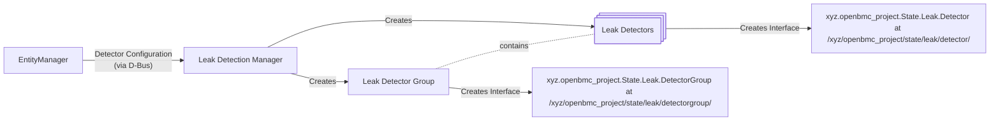

# 液體洩漏偵測

Author: Jagpal Singh Gill <paligill@gmail.com>

Created: July 26, 2024

## 問題描述

在資料中心環境的高效能運算領域，液態冷卻正逐漸成為傳統氣流散熱之外一個極具前景的替代方案。然而，這項技術也有其本身的挑戰，因為液體可能對電子元件造成損害。因此，任何採用液態冷卻的系統都必須具備偵測與回報洩漏的機制，以便採取相應的補救措施。目前 openBMC 中還沒有可用來處理此任務的服務。

## 背景與參考資料

在本文件中，洩漏被視為一個具有數位值（存在或不存在）的實體。目前 openBMC 已有一套感測器框架，但它主要是為數值讀取而設計，而非為具有數位值的偵測器所設計。
[phosphor-gpio-monitor](https://github.com/openbmc/phosphor-gpio-monitor) 的設計過於通用，無法滿足大多數的需求。

## 需求

1. 能夠辨識基於 GPIO 的偵測器是否發生洩漏，並產生相對應的 redfish 事件。
2. 能夠根據特定屬性，按照嚴重程度對洩漏事件進行分級。
   - 舉例來說，可以利用偵測器的實體位置來判定洩漏的嚴重程度。若洩漏被侷限在托盤（tray）範圍內，可視為輕微；但當它蔓延到集液盤（drip pan）時，其嚴重程度就會提高。
3. 能夠根據洩漏分級執行相應的動作，且此動作可選擇性地委派給其他元件處理。
4. 能夠產生一個符合
   [Redfish Leak Detection](https://redfish.dmtf.org/schemas/v1/LeakDetection.v1_0_1.json)
   標準的 D-Bus 介面，讓客戶端可以取得洩漏偵測的狀態。

## 建議設計

### Dbus 介面

洩漏偵測的 DBus 介面將包含以下內容 -

| Interface Name                               | New/Existing |        Purpose/Updates         |
| :------------------------------------------- | :----------: | :----------------------------: |
| xyz.openbmc_project.State.Leak.DetectorGroup |     New      | Implements Leak Detector Group |
| xyz.openbmc_project.State.Leak.Detector      |     New      |    Implements Leak Detector    |

相關的 D-Bus 變更請參考
[patch](https://gerrit.openbmc.org/c/openbmc/phosphor-dbus-interfaces/+/73151)。

### BMCWeb

本設計需要在 BMCWeb 中實作以下的 Redfish schema 及相關屬性。

|  Redfish Schema  |                               Properties                                |
| :--------------: | :---------------------------------------------------------------------: |
| ThermalSubsystem |                              LeakDetection                              |
|  LeakDetection   |             Name, Status, LeakDetectors, LeakDetectorGroups             |
|                  | LeakDetectorGroup: GroupName, Detectors, Detectors\@odata.count, Status |
|   LeakDetector   |                       Name, DetectorState, Status                       |

NOTE: 之所以需要 ThermalSubsystem，是因為它包含了 LeakDetection 端點。

### Liquid Leak Detector



#### Entity Manager 設定

##### Json Schema

關於洩漏偵測器的設定 schema 資訊，請
[參考](https://gerrit.openbmc.org/c/openbmc/entity-manager/+/75734)。

##### 設定範例

以下是洩漏偵測器的 entity manager 設定範例 -

```json
"Exposes": [
...
  {
  "Type": "GPIOLeakDetector",
  "Name": "ManifoldFrontDetector",
  "SubType": "LeakSensingCable",
  "PinName": "DETECTOR1_GPIO",
  "Polarity": "ActiveLow",
  "Level": "Critical"
}
...
]
```

#### LeakDetection Manager

LeakDetection Manager 負責透過 DBus 處理來自 Entity Manager 的輸入設定物件。根據相關的介面訊號，它會建立或刪除對應的偵測器及偵測器群組 D-Bus 介面。此外，它會監控偵測器的 GPIO 事件，並在偵測到洩漏時根據洩漏等級觸發對應的 systemd targets，同時升起或解除適當的洩漏相關告警。這滿足了需求 #1 與 #3。

### 錯誤回報

針對透過 Redfish 回報的事件，本設計提出了一項
[leak detection](https://gerrit.openbmc.org/c/openbmc/phosphor-dbus-interfaces/+/73707)
定義，依據的是
[event logging design](https://github.com/openbmc/docs/blob/master/designs/event-logging.md)。

#### 洩漏嚴重程度

entity manager 的設定會指定洩漏偵測器的嚴重等級。當對應的偵測器偵測到洩漏時，LeakDetection Manager 會產生一個事件訊息，其嚴重等級如設定中所定義。這滿足了需求 #2。

## 曾考慮的替代方案

### phosphor-gpio-monitor

phosphor-gpio-monitor 目前的設計過於通用，無法滿足大多數需求，特別是需求 #2 與 #4。若要修改 phosphor-gpio-monitor 以加入這些需求，將會使它變成一個單體式（monolithic）的 daemon，而每當有其他類似功能時都得再次擴展它。目前 phosphor-gpio-monitor 以簡潔的方式有效執行其通用任務，因此更適合維持現狀。

## 影響

### API 影響

- 本設計提出了一項新的洩漏偵測 D-Bus 介面，這需要在 BMCWeb 中進行實作。

### 效能影響

由於需要處理洩漏偵測器的 GPIO 事件，本設計可能會使系統效能輕微下降，但影響微乎其微。

### 組織層面

- 此 repo 是否需要一個新的 repo？不需要。
- 誰將是本 repo 的初始維護者？NA
- 預計需要修改哪些 repo 才能執行本設計？BMCWeb、
  dbus-sensors、phosphor-dbus-interfaces
- 列出一份清單，並將所列 repo 的維護者加入 gerrit review。

## 測試

### 單元測試

參考實作的所有功能測試都將使用 GTest 執行。

### 整合測試

產生 Redfish 事件的整合測試將使用 GPIO 模擬工具來模擬洩漏偵測 GPIO，可依需要觸發這些 GPIO。
