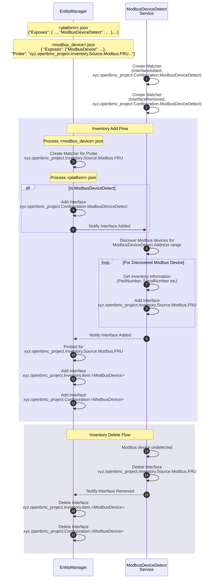

# 基於 Modbus 的硬體庫存

作者：Jagpal Singh Gill <paligill@gmail.com>

其他貢獻者：Amithash Prasad <amithash@meta.com>

建立日期：2025 年 1 月 14 日

## 問題描述

某些裝置可以透過 Modbus 介面（RTU 或 TCP）連線到 BMC。然而，openBMC
目前尚不支援探索這些裝置，也無法揭露其相關的庫存與感測器存取詳細資訊。
本提案旨在引入一個基於 Modbus 的硬體庫存模型。本文件的範圍將著重於
RTU（序列）連線，但此設計可延伸擴展，以因應未來的 TCP 連線。

## 背景與參考資料

- [Modbus 規格](https://www.modbus.org/docs/Modbus_Application_Protocol_V1_1b3.pdf)
- [Belimo 流量計 Modbus 介面](https://www.belimo.com/mam/general-documents/system_integration/Modbus/belimo_Modbus-Register_22PF_V4_2_en-gb.pdf)

## 需求

- 能夠偵測並辨識連線到系統的 Modbus 裝置，包括以不同裝置類型串接
  （daisy-chained）在序列連結上的裝置。
- 能夠從探索到的 Modbus 裝置讀取並揭露庫存資訊。
- 能夠透過 Entity Manager 將 Modbus 裝置呈現為庫存項目。
- 能夠處理 Modbus 裝置的線上移除，確保裝置庫存及相關資料確實清理。

## 建議設計

### 建議的端到端流程



_ModbusDetectDevice_ 服務負責探測 Modbus 裝置，並將其 FRU 庫存資訊
提供到 D-Bus 上，從而滿足需求 #1 與 #2。此外，它也處理 Modbus 裝置的
移除，包含刪除其庫存資料，進而達成需求 #4。

Entity Manager 的 global.schema 將更新以納入相關的 Modbus 裝置作為
庫存項目，其做法如該
[修補程式](https://gerrit.openbmc.org/c/openbmc/entity-manager/+/77350)
所示。此變更滿足需求 #3。

### 建議的 D-Bus 介面

Modbus 硬體庫存的 DBus 介面將包含以下項目：

- [xyz.openbmc_project.Configuration.ModbusDeviceDetect](https://gerrit.openbmc.org/c/openbmc/phosphor-dbus-interfaces/+/77293)
  - 提供設定詳細資訊，包括 Modbus 位址範圍與暫存器，以協助探索
    Modbus 裝置。

- [xyz.openbmc_project.Inventory.Source.Modbus.FRU](https://gerrit.openbmc.org/c/openbmc/phosphor-dbus-interfaces/+/77294)
  - 提供裝置存取詳細資訊，包括 Modbus 位址與 LinkTTY 資訊，以及所有
    探索到的 Modbus 裝置的庫存資料。

### 建議的 EM Schema 定義

#### SerialPort

關於此 schema 定義的詳細資訊，請
[參考](https://gerrit.openbmc.org/c/openbmc/entity-manager/+/80242)。以下為此
schema 的 entity manager 設定範例：

```json
"Exposes": [
...
{
  "Type": "SerialPort",
  "Name": "ttyS0",
  "Mode": "RS485",
  "BaudRate": 115200,
  "DataParity": "Odd"
}
...
]
```

#### ModbusDeviceDetect

關於此 schema 定義的詳細資訊，請
[參考](https://gerrit.openbmc.org/c/openbmc/entity-manager/+/77223)。以下為此
schema 的 entity manager 設定範例：

```json
"Exposes": [
...
{
  "Type": "ModbusRTUDetect",
  "Name": "Flow Meter 1",
  "Address": [
    {
      "RangeStart": 12,
      "RangeEnd": 20
    },
    {
      "RangeStart": 50,
      "RangeEnd": 100
    }
  ],
  "DataEndianness": "Little",
  "SerialPort": [
    "ttyS0"
  ],
  "Registers": [
    {
      "Name": "PartNumber",
      "Address": 100,
      "Size": 6,
      "Format": "String"
    },
    {
      "Name": "SerialNumber",
      "Address": 200,
      "Size": 4,
      "Format": "String"
    }
  ]
}
...
]
```

### 建議的庫存項目

以下為部分建議的項目，此設計可延伸擴展，依需求納入新的項目。

- [xyz.openbmc_project.Inventory.Item.ValveTrain](https://gerrit.openbmc.org/c/openbmc/phosphor-dbus-interfaces/+/77416)
  - 關於對應的 Entity Manager Schema 定義，請
    [參考](https://gerrit.openbmc.org/c/openbmc/entity-manager/+/77415)。
- [xyz.openbmc_project.Inventory.Item.FlowMeter](https://gerrit.openbmc.org/c/openbmc/phosphor-dbus-interfaces/+/77417)
  - 關於對應的 Entity Manager Schema 定義，請
    [參考](https://gerrit.openbmc.org/c/openbmc/entity-manager/+/77350)。

## 曾考慮的替代方案

另一種替代做法是由板子設定（board configurations）揭露所有相關的 Modbus
暫存器（包含庫存），供感測器監控常駐程式（daemons）使用。接著由這些常駐
程式負責揭露庫存項目，這樣可簡化流程，但會讓監控常駐程式變得更複雜，因為
它需要處理庫存項目介面，並重寫 Entity Manager 的現有程式碼。然而，此建議
的流程更符合現有標準，其中 ModbusDeviceDetect 服務用於 Modbus 裝置探索，
其角色類似 FRU 裝置常駐程式。

## 影響

### 效能影響

此設計可能會因為定期檢查 Modbus 裝置是否存在而導致系統效能些微下降，
但此影響可忽略不計。

### 組織面

- 本提案是否需要新的 code repository？
  - 是
- 誰將是這個 repository 的初始維護者？
  - Patrick Williams、Jagpal S Gill、Amithash Prasad
- 預期需要修改哪些 repositories 以執行此設計？
  - EntityManager
- 請列出清單，並將所列 repository 的維護者加入 gerrit 審查。

## 測試

### 單元測試

參考實作的所有功能測試都將使用 GTest 執行。

### 整合測試

涉及伺服器（例如 BMCWeb）的端到端整合測試將使用
openbmc-test-automation 涵蓋。
