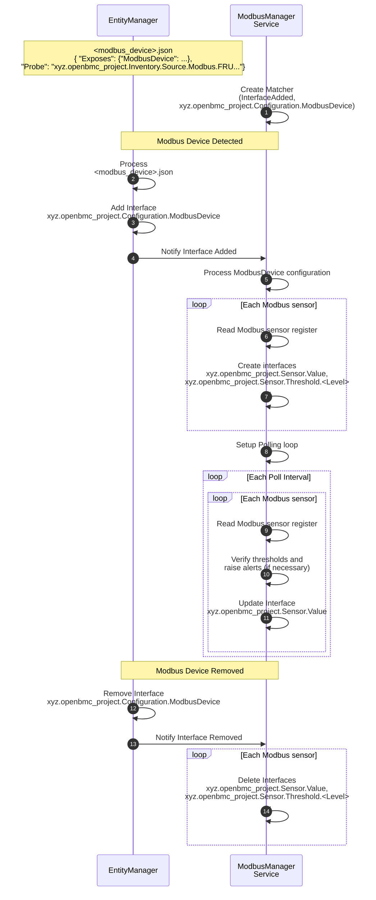

# Modbus 感測器與管理

作者：Jagpal Singh Gill <paligill@gmail.com>

其他貢獻者：Amithash Prasad <amithash@meta.com>

建立日期：2025 年 1 月 21 日

## 問題描述

有些裝置可以透過 Modbus 介面連線到 BMC。然而，openBMC 目前缺乏一項服務，
能夠為這些裝置監控感測器，以及執行韌體清單與更新等管理功能。本提案描述
一個專為監控與管理 Modbus 裝置而設計的服務。主要著重於 Modbus RTU（序列）
連線，並保留彈性，未來可支援如 TCP 等其他 Modbus 介面。雖然本設計以 Modbus
流量計的使用情境為焦點，但其架構具備可擴充性，可調整以新增對新裝置類型的
支援。

## 背景與參考資料

已有一項相關設計提案用於
[Modbus 硬體清單](https://gerrit.openbmc.org/c/openbmc/docs/+/77318)，
其目標是探索對應的 Modbus 裝置並建立相關的清單項目。本設計即以 Modbus
清單設計的基礎之上建構而成。

更多參考資料請見：

- [Modbus 規格](https://www.modbus.org/docs/Modbus_Application_Protocol_V1_1b3.pdf)
- [Belimo 流量計 Modbus 介面](https://www.belimo.com/mam/general-documents/system_integration/Modbus/belimo_Modbus-Register_22PF_V4_2_en-gb.pdf)

## 需求

1. 能夠定義裝置存取設定，例如感測器資料的 Modbus 暫存器。
2. 能夠指定用於監控的感測器閾值，並能在超過閾值上限或恢復時觸發與解除
   事件。
3. 能夠讀取 Modbus 裝置的韌體版本並提供給用戶端。
4. 能夠更新 Modbus 裝置的韌體。
5. 能夠回報特定裝置的 Redfish 事件／錯誤，例如：
   - 回報液冷裝置中溫度感測器的故障狀態。
   - 回報液冷裝置中流量方向錯誤。
6. 支援序列連線上的 Modbus RTU（功能有限），採用主從（master-slave）模型，
   其中主機（master）在單播模式下一次只能與一個從機（slave）通訊。
7. 能夠有效率地輪詢序列連線（例如 RS485）上的 Modbus 裝置，該連線最多可
   支援 32 個串接（daisy-chained）裝置。
8. 透過以 Redfish 為基礎的 REST 介面暴露感測器、韌體與狀態資訊供用戶端存取。

## 提案設計

### 提案的端到端流程



### 提案的 D-Bus 介面

- [xyz.openbmc_project.Configuration.ModbusDevice](https://gerrit.openbmc.org/c/openbmc/phosphor-dbus-interfaces/+/77299)
  - 提供設定細節，例如感測器、狀態位元元以及供感測器監控與韌體管理服務
    使用的 Modbus 裝置韌體暫存器。

此外，也將使用以下既有介面 -

- xyz.openbmc_project.Association.Definitions
  - 實作到清單項目（inventory item）的
    [inventory](https://github.com/openbmc/phosphor-dbus-interfaces/blob/master/yaml/xyz/openbmc_project/Inventory/Item.interface.yaml#L97)
    關聯。較佳替代方案可能是
    [monitoring](https://github.com/openbmc/phosphor-dbus-interfaces/blob/master/yaml/xyz/openbmc_project/Inventory/Item.interface.yaml#L74)
    關聯。
- xyz.openbmc_project.State.Decorator.Availability
- xyz.openbmc_project.State.Decorator.OperationalStatus
- xyz.openbmc_project.Sensor.Value
- xyz.openbmc_project.Sensor.Threshold.Critical
  - 較佳替代方案可能是 xyz.openbmc_project.Common.Threshold
- xyz.openbmc_project.Sensor.Threshold.Warning
  - 較佳替代方案可能是 xyz.openbmc_project.Common.Threshold

這些介面將於
`/xyz/openbmc_project/sensors/<SensorType>/<SensorName>` objectPath 建立，
其中 `<SensorType>` 與 `<SensorName>` 對應到 ModbusDevice EM 設定中所定義的
屬性。下表說明液冷裝置一些可能的感測器類型及其相關資訊。

| 感測器類型    | 感測器物件路徑                              | 單位              |
| ------------- | ------------------------------------------ | ----------------- |
| LiquidFlow    | /xyz/openbmc_project/sensors/liquid_flow   | LPM               |
| Temperature   | /xyz/openbmc_project/sensors/temperature   | DegreesC          |
| Volume        | /xyz/openbmc_project/sensors/volume        | CM（立方米）      |
| Concentration | /xyz/openbmc_project/sensors/concentration | Percent           |

更多詳細資訊請
[參考](https://gerrit.openbmc.org/c/openbmc/phosphor-dbus-interfaces/+/77542)。

### ModbusDevice EM 結構定義

關於結構定義的詳細資訊，請
[參考](https://gerrit.openbmc.org/c/openbmc/entity-manager/+/77289)。以下是此
結構的 entity manager 設定範例 -

```json
"Exposes": [
...
{
  "Type": "ModbusRTUFlowMeter",
  "Name": "Flow_Meter_1_12",
  "Address": 12,
  "SerialPort": "ttyUSB1",
  "DataEndianness": "Little",
  "SensorRegisters": [
    {
      "Name": "AbsoluteVolumetricFlow",
      "Address": 7,
      "Size": 2,
      "Format": "Float"
    },
    {
      "Name": "GycolConcentration",
      "Address": 25,
      "Size": 2,
      "Format": "Integer"
    }
  ],
  "FirmwareRegister": {
    "Name": "Firmware",
    "Address": 103,
    "Size": 2,
    "Format": "String"
  },
  "StatusBits": [
    {
      "Name": "CoolantLoopBlocked",
      "Address": 37378,
      "Position": 1
    }
  ]
}
...
]
```

### 處理 Modbus RTU 序列連線的限制

Modbus RTU 序列連線通訊採用主從（master-slave）模型，其中主機在單播模式下
一次只能與一個從機通訊。為處理此限制，所有送往序列線的通訊都可透過一個
處理佇列進行序列化。主機從此佇列取得訊息並依序處理，確保在單播模式下對
單一從機的獨佔存取。此舉滿足需求 #6。

### 有效率地存取 Modbus

承接上一節，為每一條序列連線各自維護一個處理佇列，可讓主機同時與多條
序列線通訊，相較於單一佇列模型能帶來更好的效能。此舉滿足需求 #7。

### Redfish 介面

為支援流量計，需在 BMCWeb 中實作以下 Redfish 結構描述（Schema）-

- [ThermalSubsystem](https://redfish.dmtf.org/schemas/v1/ThermalSubsystem.v1_3_3.json)
- [CoolantConnector](https://redfish.dmtf.org/schemas/v1/CoolantConnector.v1_1_0.json)
- [CoolingLoop](https://redfish.dmtf.org/schemas/v1/CoolingLoop.v1_0_3.json)

### 提案的事件

#### 液冷裝置的 Redfish 環境錯誤與事件

依據
[Standard Redfish Environmental](https://www.dmtf.org/sites/default/files/standards/documents/DSP2065_2024.4.pdf)
規格，為液冷裝置定義了以下幾類錯誤與事件：

- _Flow Rate_：與液態冷卻劑流量相關的錯誤與事件。
- _Fluid Level_：與液態冷卻劑液位相關的錯誤與事件。
- _Temperature_：與液態冷卻劑溫度相關的錯誤與事件。

#### 液冷裝置的 OpenBMC 命名空間錯誤與事件

除了標準的 Redfish 環境錯誤與事件之外，還需為 openBMC 命名空間中的液冷
裝置定義以下自訂錯誤與事件：

- _Temperature Sensor Faulty_：表示液冷裝置中溫度感測器故障的錯誤。
- _Reverse Flow_：表示液冷裝置中流量方向錯誤的錯誤。
- _Wrong Coolant Type_：表示液冷裝置中使用不正確或不相容冷卻劑類型的錯誤。

### 韌體清單與更新

已在 modbus_device 的
[Entity Manager 設定](https://gerrit.openbmc.org/c/openbmc/entity-manager/+/77289)
中提出 _FirmwareVersionRegisterAddress_。此欄位將指定韌體暫存器的 Modbus
位址，讓 Modbus 守護行程得以取得裝置的韌體版本，並透過 D-Bus Version 介面
顯示。更多關於韌體清單與更新設計的詳細資訊，請
[參考](https://github.com/openbmc/docs/blob/master/designs/code-update.md)。

## 已考量的替代方案

另一種設計選項是將 Modbus 守護行程拆分為較小的、依裝置而分的守護行程
（例如流量計、機架泵送單元等）。然而，此做法受限於需求 #6 中提及的 RTU
限制，因為不同类型與位址的多個裝置可能共存於同一條連線之上。因此，單一的
Modbus 守護行程主機是更為合適的選擇。

## 影響

### 效能影響

定期輪詢 Modbus 感測器可能會造成系統效能些微下降，但可透過可設定的設定值
調整輪詢間隔來緩解。

### 組織面向

- 本提案是否需要新的倉庫（repository）？
  - 是
- 誰將是此倉庫的初始維護者？
  - Patrick Williams、Jagpal S Gill、Amithash Prasad
- 預期需要修改哪些倉庫以執行本設計？
  - EntityManager
- 列出清單，並將所列倉庫的維護者加入 gerrit 審查。

## 測試

### 單元測試

參考實作的所有功能測試將使用 GTest 執行。

### 整合測試

涉及伺服器（例如 BMCWeb）的端到端整合測試將使用 openbmc-test-automation
涵蓋。
