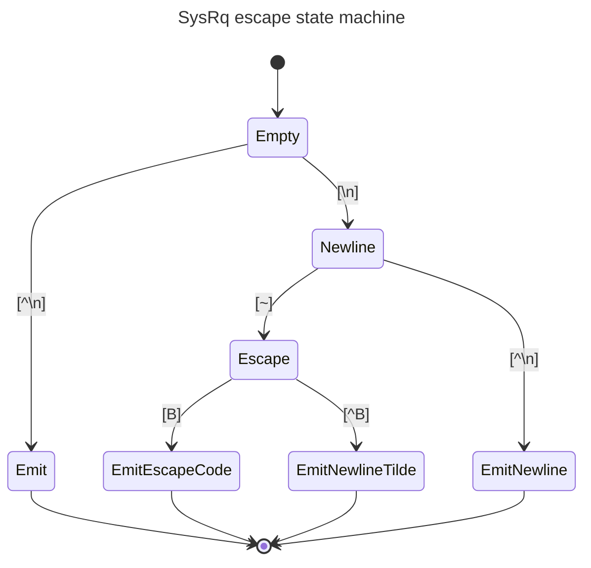

# SOL 中的 SysRq 支援

作者：Lei Yu <LeiYU!>

其他貢獻者：Chen Tingting、Xie Xinnan

建立日期：2023 年 8 月 2 日

## 問題描述

[SysRq][1] 是 Linux 用來執行各種低階命令的特殊按鍵組合。BMC 通常在 KVM
與 SOL 功能中提供 SysRq 支援，但 OpenBMC 並沒有這個功能。本文件旨在為
OpenBMC 的 SOL 提供 SysRq 支援。

## 背景與參考資料

該按鍵組合由 Alt+SysRq（通常是 `PrintScreen` 鍵）以及另一個按鍵組成，
後者決定所要發出的命令。這不是標準的按鍵碼，需要特別處理。序列主控台
（serial console）通常會先送出一個序列中斷信號（serial break signal），
接著再送出所需的按鍵，藉此呼叫 SysRq 功能。這個「中斷信號」通常由
`ctrl+break` 按鍵組合產生。[2]

在 ipmitool 中，「中斷信號」是在 [ipmi_sol.c][3] 裡透過處理特殊的
`\n~B` 按鍵來實作的。

## 需求

OpenBMC SOL 有幾種使用方式：

- ipmitool SOL。
- WebUI 中的 SOL。
- 透過 SSH（預設）2200 端點的主控台。

## 提案設計

在 OpenBMC 中，`obmc-console-server` 服務提供主機主控台，並且可以由多個
用戶端透過 unix domain socket 連線。

為了在 OpenBMC SOL 中為 ipmi 與 WebUI 實作 SysRq，會使用特殊的按鍵碼序列
`\n~B` 在用戶端與 console-server 之間傳送「中斷信號」。在 `obmc-console`
中，應由一個狀態機來處理該序列。一旦偵測到該序列，即可呼叫
`tcsendbreak()` 將「中斷信號」傳送至主機（Host）。

### netipmid

在 `phosphor-ipmi-net` 中，`processInboundPayload()` 裡的程式碼應處理來自
ipmitool 的中斷信號，並將序列 `\n~B` 傳送至伺服器。

之後在 ipmitool SOL 工作階段中，使用者可以輸入 `\n~B` 按鍵來觸發中斷，
接著再輸入一個按鍵碼作為 SysRq 命令。

### WebUI

WebUI 不需要任何修改。與 netipmid 一樣，使用者可以輸入按鍵碼序列 `\n~B`
來觸發中斷，接著再輸入一個按鍵碼作為 SysRq 命令。

### obmc-console

作為 obmc-console 伺服器，在 `console-server.h` 中使用一個簡單的狀態機來
偵測序列 `\n~B`：

若到達 `EmitEscapeCode` 狀態，就應呼叫 `tcsendbreak()` 將「中斷訊息」
傳送至主機（Host）。

## 其他考慮過的方案

在用戶端與 console-server 之間傳送「中斷信號」的另一種方式，是使用
`MSG_OOB` 作為 sysrq 的指示信號。`MSG_OOB` 已經作為 sysrq 的指示信號
引入到 [netipmid][4]。在此方案中，需要修改 bmcweb，在使用者輸入按鍵碼
序列 `\n~B` 時將 `MSG_OOB` 傳送至 obmc-console。當 obmc-console 收到
`MSG_OOB` 時，它就應將「中斷訊息」傳送至主機。

然而，在此方案中，某些情況下 obmc-console 無法正確處理輸入序列，因為
`MSG_OOB` 可能出現在輸入序列的任何位置。雖然可以使用
[sockatmark(3)][5] 將 `MSG_OOB` 與串流同步，但這需要在所有 obmc-console
用戶端中都對 `MSG_OOB` 進行信號處理，其工作量比狀態機方案更大。

## 影響

以下服務需要些微修改以加入 SysRq 支援：

- netipmid
- obmc-console

## 測試

SOL 中的 SysRq 可以在 ipmitool SOL 與 WebUI SOL 兩者進行驗證。在透過 SSH 的
SOL 中，我們需要輸入帶有超過一個波浪符號（tilde）的按鍵碼序列。例如序列
`\n~~B`，第一個波浪符號會由 obmc-console-client 處理，第二個波浪符號則會
抵達 obmc-console-server。

[1]: https://en.wikipedia.org/wiki/Magic_SysRq_key
[2]: https://www.kernel.org/doc/html/latest/admin-guide/sysrq.html
[3]: https://github.com/ipmitool/ipmitool/blob/master/lib/ipmi_sol.c#L1398-L1401
[4]:
  https://github.com/openbmc/phosphor-net-ipmid/commit/ec4374146147e339132243725d345eb30ec2da1d
[5]: https://man7.org/linux/man-pages/man3/sockatmark.3.html
